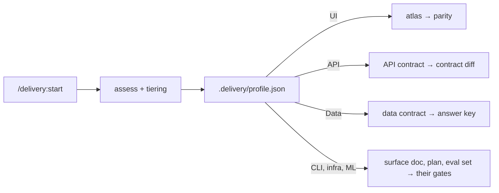

# Gate checklist

Print it, or copy it into the project as a tracking issue. Do not start a phase until the one
before it is ticked. Each box needs evidence: a file, a command's output, or the owner's written
word.

Project: `<PROJECT>` · Surfaces: ☐ UI ☐ API ☐ Data ☐ CLI/library ☐ Infra ☐ ML · Tier: ☐ S ☐ M ☐ L ·
Track: ☐ Brownfield ☐ Greenfield ☐ Adopt midway · Jira: `<JIRA_KEY>` ·
Initiative label: `<INITIATIVE>`

## Step 0 · Assess
Command: `/delivery:start` (runs `/delivery:assess` and `/delivery:tiering`)

| Surface | Contract artefact | Verification gate | E2E / integration |
| --- | --- | --- | --- |
| UI | Mockup atlas | Screenshot parity, independent reviewer | Device or browser E2E on staging |
| API / service | OpenAPI, AsyncAPI or protobuf + sequences | Contract and consumer-driven tests, contract diff | API tests, ephemeral or staging env |
| Data / pipeline | Data contract + golden dataset with answer key | Output equals the answer key; quality checks; reproducible | Pipeline run on the golden dataset |
| CLI / library | Public API surface + usage examples | Doctests, golden CLI output, semver check | Golden CLI runs |
| Infra | Architecture diagram + IaC plan | Plan diff, policy checks (plan only) | Plan against a sandbox |
| ML / model | Eval set + answer key + decision rule | Scores meet the rule on named hardware | Eval harness |

- [ ] `.delivery/profile.json` and `.delivery/PROFILE.md` written; surfaces confirmed by the owner, with evidence
- [ ] Tier (S, M, L) chosen with the owner, with the reason
- [ ] Risk flags confirmed: sensitive data, regulated domain, multi-repo, backend dependencies
- [ ] Each surface has its contract artefact and verification gate named (UI: atlas and parity; API: contract and contract diff; data: data contract and answer key; CLI: surface doc and golden output; infra: plan diff; ML: eval and decision rule)
- [ ] Every phase below is on, off or swapped in `PROFILE.md`. Skip the sections that are off; read "atlas" and "parity" as the profile's contract and gate where swapped
- [ ] `.delivery/guards.json` in place; the owner knows how to approve a commit (`touch .delivery/APPROVED`)

## 0 · Bootstrap
Command: `/delivery:bootstrap-brownfield` · `/delivery:bootstrap-greenfield` · `/delivery:adopt-midway`
- [ ] Untracked docs backed up before anything was touched (path: ________)
- [ ] Bootstrap report read by the owner. Every question is answered or deferred
- [ ] Brownfield: `.graphifyignore` from `templates/graphifyignore`; code graph built (`graphify update .`); `graphify-out/` gitignored except `GRAPH_REPORT.md`; the report read
- [ ] Brownfield: codebase survey covers stack, modules, tests, CI, lint, environments, security-sensitive paths, how to run and test
- [ ] Greenfield: the stack decision is recorded in `DECISIONS.md` with the options and tradeoffs
- [ ] Adopt midway: the inventory maps every existing artefact to a phase, and the gap list is agreed

## 1 · Project setup
Command: part of the bootstrap skill
- [ ] `CLAUDE.md` §0 lists every trap found so far, each with symptom, cause and fix
- [ ] `CLAUDE.md` §1 summarises the constitution (or a draft of it)
- [ ] `AGENTS.md` carries the owner's rules and a *Project Learnings* list
- [ ] Existing instructions kept (brownfield): nothing dropped without the owner
- [ ] Jira project, epics and the `<INITIATIVE>` label exist
- [ ] `.env` holds `JIRA_SITE`, `JIRA_USER`, `JIRA_TOKEN`, and `git check-ignore .env` prints `.env`
- [ ] `python3 tools/jira.py show <JIRA_KEY>-1` works
- [ ] Conventions in `CLAUDE.md` §3: key in branch, commit subject and code comments; no markdown TODO lists

## 2 · Capture the before (brownfield; skip for greenfield)
Command: `/delivery:capture-before`
- [ ] Staging only. The account is synthetic (`<SYNTHETIC_PATTERN>`), never a real person
- [ ] The seed is generated, stamped SPECIMEN, with no real names, numbers or documents. `design/seed.md` records it
- [ ] `<CAPTURE_SWITCH>` is a no-op in production, and a test proves it
- [ ] The capture flow is in the repo, and credentials are passed with `-e` (or the tool's equivalent)
- [ ] Every PNG in `design/before/` was opened and checked. Unreachable screens are in `MISSING.md`

## 3 · Research and review
Command: `/delivery:atlas` (UI) · `/delivery:contract` (other surfaces)
- [ ] `design/research.md`: every claim has a URL and access date, or is marked unverified
- [ ] `design/review.md` (brownfield): findings per screen, scores, the top ten, must-not-lose features
- [ ] At least one independent design review by a reviewer that did not draw the screens
- [ ] The owner has read the top ten changes

## 4 · Mockup atlas
Command: `/delivery:atlas` (UI) · `/delivery:contract` (other surfaces)
- [ ] Backed up before every change (`uv run backup.py`)
- [ ] `kit.py` is the only styling source. Every seed fact comes from its facts block
- [ ] Every screen has a stable id, purpose, reached-from and goes-to
- [ ] `build_atlas.py`: 0 duplicate ids, 0 ambiguous prefixes, 0 unowned screens
- [ ] Unresolved links: 0, or each one listed with a reason
- [ ] Every rendered PNG opened and checked
- [ ] Design review rounds done. Each finding fixed, or rejected with a reason
- [ ] The owner approved the atlas (line in `DECISIONS.md`, with the date)

## 5 · Decisions and open questions
Command: `/delivery:decisions`
- [ ] `DECISIONS.md` exists, is dated, and says it wins over every other document
- [ ] Every open question has a recommendation and names what it blocks
- [ ] Every answer has been applied to the atlas source and rebuilt
- [ ] `GLOSSARY.md` covers every noun on the atlas, with banned synonyms
- [ ] `DISCREPANCIES.md` exists. Old entries are triaged (open, resolved or carried)

## 6 · Backend split
Command: `/delivery:backend-split`
- [ ] `BACKEND-AUDIT.md`: the commit read per repo, and file:line for every "exists" claim
- [ ] Every `BACKEND` screen item exists in `ITEMS`. Every item has a fallback or `None`
- [ ] Every item is classified: ships reduced, deferred, or critical
- [ ] Critical list empty, or approved by the owner with reasons
- [ ] `BACKEND-SPLIT.md` regenerated, not hand-edited

## 7 · Constitution
Command: `/delivery:constitution`
- [ ] The owner chose the non-negotiables
- [ ] It includes: the atlas is the contract; three test layers; parity by an independent reviewer; minimal backend; nothing fails silently; one concept, one name; Jira as the progress record; governance and versioning
- [ ] Version and Sync Impact Report are current. `CLAUDE.md` §1 cites the same version
- [ ] Old version strings searched for and updated

## 8 · Architecture
Command: `/delivery:architecture`
- [ ] Brownfield: module map and hot spots taken from `GRAPH_REPORT.md`
- [ ] Every **[V]** claim has a file:line (brownfield)
- [ ] The conflicts section is copied into `DISCREPANCIES.md`
- [ ] Mermaid diagrams present (context, modules, key flows, state machines, data flow, deployment) and compile
- [ ] archify diagrams for the overview and key workflows in `docs/diagrams/` (JSON source committed), `archify validate` passes

## 9 · Specs and verification
Command: `/delivery:specify-from-atlas` · `/delivery:verify-specs`
- [ ] `specs/` backed up before agents rewrote it
- [ ] Every spec has a Build line, a Jira line, stories with screen ids, numbered FRs, and backend tags with fallbacks
- [ ] Every spec has `checklists/requirements.md` with atlas coverage
- [ ] `design/ui-review/NNN.md` for every spec that owns screens
- [ ] Brownfield: the Overview cites code. `TRACEABILITY.md` maps every current capability
- [ ] Verification: screen coverage complete, 0 bad screen ids, 0 unresolved FR references, 0 duplicate FRs
- [ ] Verification: every decision traced to an FR. Contradictions resolved or listed for the owner
- [ ] Every spec with stories has a flow diagram per story, and every Mermaid block compiles
- [ ] No FR renumbered (withdrawn ones keep their number)

## 10 · Plans and tasks
Command: `/delivery:plan-and-tasks`
- [ ] Each plan agent wrote only to its own spec folder and its own `plan-discrepancies.md`
- [ ] No agent ran a branch-switching setup script
- [ ] Every Constitution Check passes the non-negotiables
- [ ] Every FR and success criterion has a task (FR → task table). No unmapped task
- [ ] Every `plan-discrepancies.md` is merged into `DISCREPANCIES.md`

## 11 · Session prompts
Command: `/delivery:sessionize`
- [ ] The Definition of done (5 steps) and the parity reviewer prompt are at the top of `SESSIONS.md`
- [ ] Every block is self-contained: guards, Jira, GAPS IN, HANDOFF, read-first, watch-fors, flows, DoD, report
- [ ] A wave-close block after every wave
- [ ] Session coverage: 0 orphan FRs
- [ ] Owner tasks listed, each naming the session it blocks
- [ ] `create_tickets.py --dry-run` parses every block with no unknown dependency
- [ ] `sessionize.py validate SESSIONS.md --strict` passes: every block self-contained

## 12 · Jira
Command: `/delivery:jira-sync`
- [ ] Story per session, task per backend item, bugs, decisions. All labelled and under an epic
- [ ] Blocks links from dependencies. Relates links from backend items to sessions
- [ ] Link direction checked by hand on one pair
- [ ] `jira-map.json` committed. Keys written back into `SESSIONS.md` headings and spec Jira lines
- [ ] `JIRA.md` index written. Filters and dashboard created. Gadgets configured once in the UI

## 13 · Each session
Command: `/delivery:session <ID>` · `/delivery:parity <spec>` · `/delivery:status`
- [ ] Ticket started. GAPS IN was the first output
- [ ] Code graph rebuilt if stale (`graphify update .`). `graphify affected` run for every changed symbol, callers confirmed with grep or the language server
- [ ] Tests written first and seen failing
- [ ] Three layers green, with pasted output and coverage at the floor
- [ ] An E2E flow for every story and screen built, passed or **NOT RUN** with a reason
- [ ] Verification file written by a fresh reviewer (UI: `design/parity/NNN.md`; other surfaces: `verification/NNN.md`), and no row is Open
- [ ] Every caller in the `affected` list is unchanged or tested
- [ ] Simpler-way review done. Leftovers are in `BACKLOG.md`
- [ ] Lint and analysis clean, with pasted output
- [ ] Diagrams updated if a flow changed. `archify validate` passes
- [ ] Evidence comment on the ticket. Done only if all the above hold
- [ ] Work staged and a commit subject proposed. **The owner commits**

## 13 · Each wave close
Command: `/delivery:close-wave <n>`
- [ ] Every flow so far re-run. Regressions traced to a session
- [ ] Whole-wave parity sweep. *Partial* rows re-run
- [ ] Discrepancy resolutions proposed (none applied without the owner)
- [ ] Real not-done list written. Seams tested

## 14 · Learning loop
Command: `/delivery:close-wave <n>` (its last step)
- [ ] Every miss this wave is a rule, a template change, or "no rule needed"
- [ ] `AGENTS.md` pruned (under 300 lines)
- [ ] Generic lessons carried back to the framework repo
