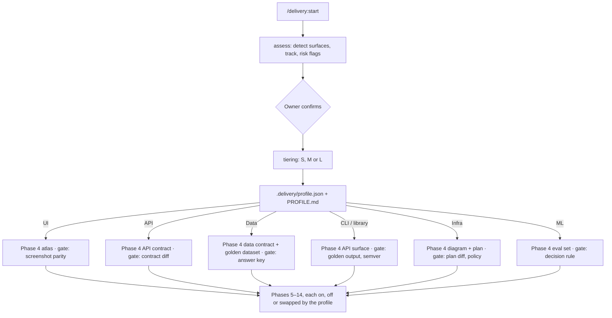

# The delivery framework, step by step

This is the full guide. [README.md](README.md) has the one-page map; [CHECKLIST.md](CHECKLIST.md)
has the gates to tick. Templates are in [templates/](templates/), agent prompts in
[prompts/](prompts/), tools in [tools/](tools/), and a worked example in
[examples/case-study-mobile-vault.md](examples/case-study-mobile-vault.md).

**As a Claude Code plugin** (`delivery`), each phase below names its skill (run as
`/delivery:<skill>`) and, where there is one, its command. Every skill reads `.delivery/profile.json`
first and skips or swaps its phase accordingly. [README.md](README.md) has the install steps.

The idea in one paragraph: **draw every screen before writing a spec, write every spec before
planning, plan against the real code, and cut the work into sessions that each fit one agent
context.** Every session proves it is done with pasted test output and an independent check against
the drawings. Nothing is committed without the owner. Every disagreement between documents is
written down and stops the work. It is never resolved silently.

---

## Step 0 · Assess

**Purpose.** Decide what kind of project this is before running anything, so a data pipeline is
never asked for mockups and an API is never checked with screenshots. Many projects have no UI.

**Plugin.** `/delivery:start` (asks for the track and tier) runs the `assess` skill, which runs
`tools/assess.py` and the `tiering` skill.

**Axes.** *Surface*: UI (mobile, web, desktop), API/service, data/pipeline, CLI/library, infra,
ML/model, or several. *Track*: brownfield, greenfield, adopt midway. *Tier*: S (ticket → PR), M (a
spec and a plan, one session), L (the full pipeline). *Risk flags*: sensitive data, regulated domain,
multi-repo, backend dependencies.

**Output.** `.delivery/profile.json` and `.delivery/PROFILE.md`: the surfaces with their contract
artefacts and verification gates, and every phase below marked **on**, **off** or **swapped**.
`.delivery/guards.json` from [templates/guards.json](templates/guards.json) turns on the guard hooks.

**The swap.** The principle stays the same on every surface: *the contract artefact is the source of
truth, and built output is checked against it by someone who did not build it*. What changes is the
artefact and the check:

| Surface | Contract artefact (atlas role) | Verification gate (parity role) | E2E / integration |
| --- | --- | --- | --- |
| UI | Mockup atlas (phase 4) | Screenshot parity, independent reviewer | Device or browser E2E on staging |
| API / service | OpenAPI, AsyncAPI or protobuf + sequence diagrams ([template](templates/contracts/API-CONTRACT.md)) | Contract tests, consumer-driven tests, contract diff | API tests on an ephemeral or staging environment |
| Data / pipeline | Data contract: schemas, dictionary, Mermaid lineage, SLAs, freshness ([template](templates/contracts/DATA-CONTRACT.md)); golden dataset with answer key ([template](templates/contracts/GOLDEN-DATASET.md)) | Output equals the committed answer key; row counts, nulls, uniqueness, referential checks; a reproducible second run | Pipeline run on the golden dataset, synthetic data only |
| CLI / library | Public API surface + usage examples | Examples run as tests (doctests, golden CLI output); semver check | Golden CLI runs |
| Infra | Architecture diagram + IaC plan | Plan diff holds only intended changes; policy checks (plan only in a pilot) | Plan against a sandbox account |
| ML / model | Eval set + answer key + benchmark hardware + decision rule | Scores meet the rule on the named hardware | Eval harness |

A mixed project combines rows. Phase 2 swaps to a baseline per surface (recorded responses, today's
outputs on the golden dataset, golden CLI output, today's plan, baseline scores). Phase 4 is the
`atlas` skill for UI and the `contract` skill for everything else. Phase 13's Definition of done
takes its steps 2 and 3 from the profile.



**Gate.** The owner has confirmed the surfaces, the tier and the risk flags. `PROFILE.md` lists every
phase as on, off or swapped, with the reason.

---

## Choose your track

| | **Brownfield** — an existing codebase | **Greenfield** — a new repo | **Adopt midway** — specs or docs already exist |
| --- | --- | --- | --- |
| Bootstrap prompt | [`00-bootstrap-brownfield.md`](prompts/00-bootstrap-brownfield.md) | [`00-bootstrap-greenfield.md`](prompts/00-bootstrap-greenfield.md) | [`00-bootstrap-adopt-midway.md`](prompts/00-bootstrap-adopt-midway.md) |
| Phase 1 | Survey the code; keep every existing instruction; find the traps | Interview the owner; choose the stack; scaffold | Inventory what exists; map it onto phases |
| Phase 2, capture the before | **Mandatory** | Skipped | Mandatory if there is a UI and no capture yet |
| Phase 3 | Research, plus a review of the current UI | Research, competitors, sketches | Only what is missing |
| Phase 4, atlas | Redesigns sit beside their before screenshots | Every screen is new; drawn from research and sketches | Rebuild existing mockups in the kit |
| Phase 6, backend | Audit what exists, with file:line; the split is grounded in it | The split lists what must be built; the audit is a target inventory | Audit if not done |
| Phase 8, architecture | Written from the code, with file:line, plus a docs-versus-code discrepancy list | A target design | Verify the existing one against code |
| Phase 9, specs | Overview cites current code as evidence; a *Carried over from today* table | Overview cites research; no carried-over table | Re-verify existing specs (phase 9 verification) |
| `TRACEABILITY.md` | **Mandatory**: every current capability → its new home, or why it was removed | Optional: needs → specs | Mandatory if replacing an existing app |
| Templates that change | `TRACEABILITY.md` (old → new), `BACKEND-AUDIT.md` (existing code) | `BACKEND-AUDIT.md` used as a target inventory; `seed.md` has no "before" | None |

The tracks merge at phase 4. From phase 4 on, every project runs the same steps, switched by the
profile from Step 0.

---

## Roles

| Who | Does | Never does |
| --- | --- | --- |
| **Owner** | Decides. Answers open questions. Approves the atlas and the constitution. Sets up Jira admin, staging accounts, devices. Commits and merges. | Lets an agent decide a product question by default. |
| **Engineer** | Pastes the prompts, one fresh agent session per block. Checks each gate. Reads the report. Runs the owner tasks that need hands (simulator, staging data). | Accepts "done" without pasted output. Commits without the owner. |
| **Agent** | Writes the documents, the atlas, specs, plans, code and tests. Moves its own Jira ticket. Stops and records every disagreement. | Commits, pushes, edits the spec it is implementing, touches production or real data. |
| **Reviewer agent** | A fresh agent with no knowledge of the code: design reviews, parity reviews, session reviews. | Reads the diff it is judging (for parity), or fixes anything. |

---

## Where things go in a project

Use these paths. Every template and prompt refers to them.

```
CLAUDE.md  AGENTS.md  ARCHITECTURE.md  SESSIONS.md  TRACEABILITY.md
.delivery/profile.json  PROFILE.md  guards.json   # Step 0 output; hook settings
contracts/api/  contracts/data/  contracts/surface/  contracts/infra/  contracts/eval/  # non-UI contracts
verification/NNN.md  verification/NNN/             # non-UI verification rounds and raw results
.specify/memory/constitution.md         # spec-kit reads it from here
.env                                    # gitignored: JIRA_SITE, JIRA_USER, JIRA_TOKEN
docs/delivery/
  DECISIONS.md  OPEN-QUESTIONS.md  GLOSSARY.md  DISCREPANCIES.md  BACKLOG.md
  BACKEND-AUDIT.md  SPEC-BRIEF.md  PLAN-BRIEF.md  SPEC-VERIFICATION.md
  JIRA.md  jira-map.json  backend-items.json
docs/diagrams/<name>.json (+ .html, .png)  # archify sources and renders
graphify-out/GRAPH_REPORT.md            # the only committed part of the code graph
.graphifyignore                         # from templates/graphifyignore
design/
  seed.md  research.md  review.md  design-review-N.md
  before/<screen-id>.png                # brownfield only
  atlas-src/                            # the generator (from tools/atlas-starter)
  atlas/index.html  atlas/this-build.html
  BACKEND-SPLIT.md                      # generated from atlas-src/backend_map.py
  ui-review/NNN.md                      # one per spec
  app/<screen-id>.png                   # captures of the built app
  parity/NNN.md                         # one per spec
specs/NNN-name/                         # spec-kit feature folders
tools/jira.py  tools/create_tickets.py  tools/jira_dashboard.py
.maestro/                               # or the platform's E2E harness
```

Placeholders used throughout: `<PROJECT>` (repo name), `<PRODUCT>` (the name users see),
`<JIRA_KEY>` (project key), `<EPIC>` (an epic key), `<INITIATIVE>` (the label for this piece of
work), `<STAGING>` (the test environment), `<CAPTURE_SWITCH>` (the test-only build flag that allows
screenshots).

---

## Code understanding and diagrams

Install once per machine with `tools/setup-tools.sh` (it installs globally, so read it first).

- **graphify** turns a codebase (about 40 languages, plus docs, SQL and config) into a queryable
  knowledge graph. It is a first-class step: brownfield bootstraps build it before anything else,
  and every later phase that reads code queries it first.
  - **Build:** `graphify update .` extracts the code locally (tree-sitter, no AI calls, no tokens)
    into `graphify-out/` (`graph.json`, `GRAPH_REPORT.md`, `graph.html`). The `/graphify` agent
    skill can add a semantic pass over docs and images, which does call a model; it is optional.
  - **Install:** `uv tool install graphifyy` (double y), then the skill for each agent you use:
    `graphify install --platform claude`, `--platform codex` or `--platform agents`.
    `tools/setup-tools.sh` does both.
  - **Ignore:** copy [templates/graphifyignore](templates/graphifyignore) to `.graphifyignore`. It
    keeps secrets, generated code, mocks, build output and design artefacts out of the graph
    (graphify also honours `.gitignore`).
  - **Commit:** only `graphify-out/GRAPH_REPORT.md`. The rest of `graphify-out/` is gitignored.
  - **Query:** `graphify query "…"`, `graphify path "A" "B"`, `graphify explain "X"`, and
    `graphify affected "X"` (everything that depends on X). Edges are tagged *extracted* or
    *inferred*; cite only extracted ones as evidence. **Agents query the graph before broad file
    reads**: it saves context.
  - **Per session:** if code changed since the graph was built (`graphify-out/graph.json` is older
    than the last commit), run `graphify update .` first. Before changing a symbol, run
    `graphify affected "<symbol>"` and list what it reports in the plan.
  - **Known limit:** call edges are incomplete for some languages and patterns (for example, widget
    construction in Dart, dynamic dispatch, reflection, dependency injection). A graph that shows no
    caller is not proof there is none: confirm with grep or the language server before changing
    shared code.
- **Mermaid** is inline in markdown and is the canonical form of every diagram. Every user flow per
  story, every state machine, and every sequence (sync, auth, handshakes) in specs and plans; the
  context, containers, data flow and deployment in `ARCHITECTURE.md`. Compile with `mmdc` before a
  doc is done.
- **archify** (an agent skill) makes polished, interactive diagrams for reviews and stakeholders:
  the architecture overview, key workflows and lifecycles. It converts a Mermaid source to its JSON
  IR. Commit the IR as `docs/diagrams/<name>.json` with the rendered HTML and PNG beside it. Run
  `node <archify skill dir>/bin/archify.mjs validate <type> docs/diagrams/<name>.json --quality
  showcase --json` in CI or the pre-PR checklist. It checks the schema, the layout, overlaps and that
  every route resolves.
- **Rule: a diagram's source is committed, never only an image.** See
  [templates/diagrams/README.md](templates/diagrams/README.md).

---

## Phase 0 · Bootstrap

**Plugin.** `bootstrap-brownfield`, `bootstrap-greenfield` or `adopt-midway`, named by `/delivery:start`.

**Purpose.** Get the repo to the point where phase 1's outputs exist and an owner can read one
report and make the first decisions.

**Who.** Engineer pastes the prompt. Agent runs it. Owner answers the questions at the gate.

**Prompt.** One of the three `prompts/00-bootstrap-*.md`.

**Outputs.** Brownfield: the code graph (`graphify update .`, built first, with
`.graphifyignore` from the template), `CLAUDE.md` and
`AGENTS.md`, `ARCHITECTURE.md` (draft, with evidence),
`docs/delivery/DISCREPANCIES.md` (docs versus code), `docs/delivery/OPEN-QUESTIONS.md`, a proposed
constitution, a backup of untracked docs, and the before capture if the owner has given a staging
account. Greenfield: the scaffold, the instructions files, the stack decision record in
`docs/delivery/DECISIONS.md`, `ARCHITECTURE.md` (target), and the tracker. Adopt midway: an
inventory and a gap list.

**Gate.** The owner has read the report and answered or deferred every question it raised.

---

## Phase 1 · Project setup

**Plugin.** Part of the bootstrap skills (phase 1 prompt).

**Purpose.** Every agent session starts with the same rules, traps and tracker.

**Who.** Agent drafts, owner approves, owner creates the Jira project and token.

**Inputs.** `~/AGENTS.md` (the owner's general rules), the codebase or the scaffold, existing
instructions.

**Outputs.**
- `CLAUDE.md` from [templates/CLAUDE.md](templates/CLAUDE.md): §0 *Things that will be got wrong*
  (every trap already hit, each with the fix), §1 non-negotiables (a summary of the constitution),
  §2 where things are, §3 tracking work, §4 commands, §5 testing, §6 secrets, §7 committing.
- `AGENTS.md` from [templates/AGENTS.md](templates/AGENTS.md): points to `CLAUDE.md`, carries the
  owner's rules and a *Project Learnings* list.
- The Jira project `<JIRA_KEY>`, one epic per feature area, one label per initiative
  (`<INITIATIVE>`), plus type labels if the team uses them.
- `.env` with `JIRA_SITE`, `JIRA_USER`, `JIRA_TOKEN`, listed in `.gitignore`.
- Conventions written into `CLAUDE.md` §3: the Jira key in the branch
  (`feat/<JIRA_KEY>-14-short-slug`), the commit subject (`<JIRA_KEY>-14: page the list`) and code
  comments that need a reference. Scratch TODOs go in a scratch tracker (for example `bd`), never
  in markdown TODO lists.

**Prompt.** [prompts/01-project-setup.md](prompts/01-project-setup.md).

**Gate.** `CLAUDE.md` §0 has at least the traps the bootstrap found. `.env` is gitignored, and
`git check-ignore .env` proves it. `python3 tools/jira.py show <JIRA_KEY>-1` works.

**Pitfalls.**
- A trap written vaguely ("be careful with screenshots") gets hit again. Write the symptom, the
  cause and the fix: "*X* hides the accessibility tree, so E2E finds nothing and fails with
  misleading selector errors; build with `<CAPTURE_SWITCH>`; never weaken *X*."
- Copying a long instruction file wholesale. Keep `CLAUDE.md` under about 150 lines and push
  reference material to `docs/AGENTS.md`.
- The commit rule must be explicit: approval of the work is not approval to commit.

---

## Phase 2 · Capture the before (brownfield)

**Plugin.** `capture-before`. On for a brownfield UI; swapped to a baseline per surface otherwise; off for greenfield.

**Purpose.** Real screenshots of today's app, so every redesign is paired with what it replaces,
and nothing is lost by accident.

**Who.** Agent writes the seed and flows. Owner provides a staging account and approves deleting old
test data.

**Inputs.** A staging environment, a synthetic test account, an E2E tool (Maestro, XCUITest,
Playwright, Espresso).

**Outputs.**
- `design/seed.md` from [templates/seed.md](templates/seed.md): the synthetic dataset, how it was
  loaded and what went wrong while loading.
- A generator for the synthetic documents (images stamped SPECIMEN, placeholder bars, no real
  names or numbers).
- `.maestro/screenshots/capture_before.yaml` (see
  [tools/maestro/capture_before.yaml](tools/maestro/capture_before.yaml)) and
  `design/before/<screen-id>.png`, plus `design/before/MISSING.md` for screens that cannot be
  reached.
- A test-only switch, `<CAPTURE_SWITCH>`, if the app blocks screenshots. It must do nothing in the
  production build, and a test must prove that.

**Prompt.** [prompts/02-capture-before.md](prompts/02-capture-before.md).

**Gate.** Every screenshot was opened and looked at: no blank, spinner, error or wrong-screen
capture. The seed contains no real data. The capture switch is a no-op in production, and a test
proves it.

**Pitfalls.**
- Screen protection can hide the whole accessibility tree from the test runner. The tests then
  fail with selector errors that look like your fault. Add a staging-only switch; never weaken the
  protection.
- Some E2E tools ignore plainly exported shell variables (Maestro 2.x reads only `-e` or
  `MAESTRO_*`), so the flow types `undefined` into the email field. Pass credentials with `-e`
  from a wrapper script.
- Importing from the photo library renames files `IMG_<timestamp>`. Import from the Files app to
  keep human names.
- A screenshot of a different screen paired with a redesign is worse than none. Record
  unreachable screens in `MISSING.md`.

---

## Phase 3 · Research and review

**Plugin.** Inside `atlas` (UI) or `contract` (other surfaces); reviews by the `design-reviewer` agent.

**Purpose.** Ground the design in current practice and in what is wrong today, then get
independent eyes on it.

**Who.** Agent researches and reviews. A fresh reviewer agent does each independent review. Owner
reads the ranked lists.

**Outputs.**
- `design/research.md`: at most two pages. A short matrix of comparable products, then 12 to 15
  principles, each with *Seen in* (with URL and access date) and *For <PRODUCT>*.
- `design/review.md` (brownfield): 3 to 5 findings per before screenshot, each tied to a principle
  or heuristic and to the file that renders it; a 1–5 score for clarity, focus and findability; the
  ten changes that matter most; the features that must not be lost.
- `design/design-review-N.md`: one per review round, by a reviewer that did not draw the screens.

**Prompt.** [prompts/03-research-and-review.md](prompts/03-research-and-review.md).

**Gate.** Every research claim has a source or is marked unverified. The owner has read the top ten
changes.

**Track notes.** Greenfield replaces the current-UI review with competitor walkthroughs and the
owner's sketches.

---

## Phase 4 · Mockup atlas

**Plugin.** `atlas` for UI. For other surfaces the profile swaps this phase for the `contract` skill (Step 0 table).

**Purpose.** One generated page that shows every screen, how you reach it and where each control
goes. The atlas becomes the UI contract: specs cite its screen ids, and the built app is compared
with it.

**Who.** Agent builds the kit and the parts, often one agent per part in parallel. Reviewer agents
run design reviews. Owner approves.

**Inputs.** Phase 3 outputs, before screenshots, the owner's brand decisions.

**Outputs** (start from [tools/atlas-starter/](tools/atlas-starter/), copied to `design/atlas-src/`.
The starter writes to `out/`. Point the output paths at the top of its scripts to `design/atlas/`,
`design/png/` and `design/BACKEND-SPLIT.md`).
- `kit.py`: the only styling source. Tokens as CSS variables, components, icons, and **one block of
  shared seed facts** (owner name, documents, dates, counts, organisations) that every screen reads.
- `parts/pN_*.py`: one module per area. Each holds a list of
  `Screen(sid, part, title, purpose, html, reached_from, goes_to, before=None)`.
- Stable screen ids: redesigns keep the before id (`07-item-actions`); new screens get the
  review's number and a slug (`S-26-export-warning`); states of one screen add a letter
  (`S-09a-…`, `S-09b-…`).
- `spec_map.py`: screen id → owning spec, by pattern rules.
- `backend_map.py`: `BACKEND` (screen → items it needs), `ITEMS` (item → title, status, fallback,
  sessions) and `REDUCED` (full screen → the reduced stand-in this build ships).
- `render_parts.py`: Playwright renders each screen to PNG at device size (for example 402×874 pt
  at 3×).
- `build_atlas.py`: writes `design/atlas/index.html` (every screen) and `this-build.html` (deferred
  screens removed, reduced stand-ins swapped in). It has a left nav by spec, in and out links,
  backend badges and a "client only" filter. It fails on duplicate ids, on ambiguous id prefixes
  and on screens with no spec.
- `build_backend_split.py`: generates `design/BACKEND-SPLIT.md` (phase 6).
- Briefs for part authors, adapted from [prompts/04-atlas.md](prompts/04-atlas.md).

**Steps.**
1. **Back up before every change**: `uv run backup.py`. Untracked mockups and specs are the most
   valuable thing in the repo and the easiest to overwrite.
2. Build the kit and one reference part. Then hand each other part to an agent with the part
   brief.
3. Render, then **open every PNG and look at it**. Fix anything clipped, overlapping or truncated.
4. Build the atlas, then fix every unresolved link: each one is a missing screen or a typo.
5. Run a design review round with a fresh reviewer, then a fix round with the fix brief. Repeat
   until the owner approves.

**Prompt.** [prompts/04-atlas.md](prompts/04-atlas.md): the kit, part, fix-round and design-review
prompts.

**Gate.** `build_atlas.py` reports 0 duplicate ids, 0 ambiguous prefixes, 0 unowned screens, and
either 0 unresolved links or a listed reason for each. Every PNG has been looked at. The owner has
approved the atlas in writing (a line in `DECISIONS.md`).

**Pitfalls.**
- **Ids colliding.** Link targets resolve by prefix (`S-28` → `S-28-due-date-editor`). Two screens
  sharing a prefix sends links to the wrong place without any error. The build must fail on
  ambiguity.
- **Copy drifting between screens.** Two parts invent different dates for the same document, or
  different counts for the same list. Every fact comes from the kit's seed block, and screens never
  inline one.
- **Agents editing the kit in parallel.** Only one agent owns `kit.py`. Part authors add local
  helpers in their own part.
- **No backup.** Agents rewrite untracked files in place. Back up first, every time.

---

## Phase 5 · Decisions and open questions

**Plugin.** `decisions`.

**Purpose.** One place where the owner's word is final, and one place where every unanswered
question has a recommendation, so work never waits on an answer.

**Who.** Agent drafts questions and recommendations. Owner answers. Agent writes the answers into
`DECISIONS.md` and applies them.

**Outputs.**
- `docs/delivery/DECISIONS.md` ([template](templates/DECISIONS.md)). **It wins over every other
  document**, the constitution included, until the constitution is amended to match.
- `docs/delivery/OPEN-QUESTIONS.md` ([template](templates/OPEN-QUESTIONS.md)): id, question,
  recommendation, what it blocks. *A session that reaches an unanswered question builds the
  recommendation and says so in its report.* The exception is a question that touches a
  non-negotiable principle. That one waits for the owner.
- `docs/delivery/GLOSSARY.md` ([template](templates/GLOSSARY.md)): one concept, one name, with the
  banned synonyms in a *Not* column.
- `docs/delivery/DISCREPANCIES.md` ([template](templates/DISCREPANCIES.md)): every disagreement
  between documents, or between a document and the code, with options, a recommendation and a
  status.

**Prompt.** [prompts/05-decisions.md](prompts/05-decisions.md).

**Gate.** Every open question has a recommendation and names what it blocks. Every answered
question is in `DECISIONS.md` and has been applied to the atlas source. The glossary covers every
noun on the atlas.

**Pitfalls.**
- Answers left in chat get lost. They go into `DECISIONS.md` the same day, with the date.
- Two names for one thing. A screen that needs an explainer to tell two concepts apart is a design
  defect, not a glossary entry.

---

## Phase 6 · Backend split

**Plugin.** `backend-split`, with one `backend-auditor` agent per backend repo. On when a client depends on a backend.

**Purpose.** Know before specifying which screens can ship on today's backend, which ship reduced
with a client fallback, and which wait. Keep the backend change to the minimum.

**Who.** Agent audits and classifies. Owner decides what is critical and what is deferred.

**Outputs.**
- `docs/delivery/BACKEND-AUDIT.md` ([template](templates/BACKEND-AUDIT.md)): for each repo, the
  commit read and what already exists, with `repo/path:line` evidence. Then a work list, item by
  item, and any client bugs found on the way.
- `backend_map.py` updated: every screen that needs the server lists its items, and every item has
  a fallback or `None`.
- `design/BACKEND-SPLIT.md` ([template](templates/BACKEND-SPLIT.md)), generated: counts, the
  client-only list, a table by item, the deferred list.

**Classification.** Each item is exactly one of:
- **Ships reduced**: it has a client fallback, so the screen ships in a stated reduced form, and
  switches to the full form when the item lands with no flag change.
- **Deferred**: no fallback, and not needed for this build. Its screens leave `this-build.html`,
  and its spec is marked *Later build*.
- **Critical**: no fallback, and this build cannot ship its stated behaviour without it. Name each
  critical item and give the reason. Aim for none.

**Prompt.** [prompts/06-backend.md](prompts/06-backend.md).

**Gate.** Every `BACKEND` screen's items exist in `ITEMS`. Every item is classified. Every
"already exists" claim has a file:line. The critical list is either empty or approved by the owner.

**Track notes.** Brownfield: the audit reads the real backend and is the evidence for every
fallback. Greenfield: the audit is a target inventory, and the split decides what the first build
needs.

---

## Phase 7 · Constitution

**Plugin.** `constitution`.

**Purpose.** A short list of principles that every plan is checked against and that a deadline
cannot waive.

**Who.** Agent drafts from [templates/constitution.md](templates/constitution.md) and the
decisions. Owner chooses the non-negotiables.

**Output.** `.specify/memory/constitution.md` (spec-kit's location; `/speckit.constitution` can
write it).

**Principles every project starts with** (adapt the wording; add product-specific ones first):
nothing fails silently; one concept, one name; tested at three layers; the atlas is the contract;
built screens match the atlas, checked by an independent reviewer (parity); minimal backend;
measured performance only; accessible by construction; Jira is the progress record. Governance:
which principles are non-negotiable, how others are waived, MAJOR/MINOR/PATCH versioning, and a
Sync Impact Report at the top of each amendment.

**Prompt.** [prompts/07-constitution.md](prompts/07-constitution.md).

**Gate.** The owner has approved the non-negotiables. `CLAUDE.md` §1 summarises the same version.
`DECISIONS.md` and the constitution do not contradict each other.

**Pitfalls.** A version bump that is not carried into `CLAUDE.md`, the specs' checklists and
`SESSIONS.md` leaves three versions in circulation. Search for the old version string after every
amendment.

---

## Phase 8 · Architecture

**Plugin.** `architecture`.

**Purpose.** How the pieces fit: what exists, what changes, and where each spec lives in the code.

**Who.** Agent writes, starting from the code graph (`graphify update .` if stale, then
`GRAPH_REPORT.md` for the module map, dependencies and hot spots, and `graphify path`/`explain` to
trace each flow, confirmed with grep or the language server where edges may be missing). Owner
reads sections 1, 9 and 11.

**Output.** `ARCHITECTURE.md` from [templates/ARCHITECTURE.md](templates/ARCHITECTURE.md): which
document wins, markers (**[V]** verified in code at file:line, **[P]** proposed, **[?]** unverified),
context, app architecture, data, key flows as sequence diagrams, the security model, the backend
boundary, the testing architecture, risks and open decisions, and the conflicts found while writing
it.

**Prompt.** [prompts/08-architecture.md](prompts/08-architecture.md).

**Diagrams.** Mermaid inline for the context, the modules, every key flow, every state machine, the
data flow and the deployment. archify versions of the overview and the two or three key workflows go
in `docs/diagrams/`, validated.

**Gate.** Every **[V]** claim has a file:line. Every conflict is copied into `DISCREPANCIES.md`.
Mermaid diagrams compile (`mmdc`). `archify validate` passes for every `docs/diagrams/*.json`.

**Track notes.** Brownfield: written from the code, and the docs-versus-code differences go to
`DISCREPANCIES.md`. Greenfield: a target design. Every section is **[P]** until code exists.

---

## Phase 9 · Specifications and the verification pass

**Plugin.** `specify-from-atlas` (cites the profile's contract ids), then `verify-specs` with the `spec-verifier` agent.

**Purpose.** One spec per feature, describing exactly what the atlas shows, testable, and tagged
with its backend dependencies.

**Who.** One agent per spec, or per group of small specs, in parallel, following the spec brief.
Then one verification agent. Owner answers what the verification pass raises.

**Inputs.** The atlas, `spec_map.py`, `backend_map.py`, decisions, glossary, constitution, the code
(brownfield) or research (greenfield).

**Outputs** per spec, written with `/speckit.specify` and then shaped to the house format:
- `specs/NNN-name/spec.md`: Feature Branch, Created, Status, a **Build** line (`This build` /
  `This build, reduced — <fallback>` / `Later build (backend)`), a **Jira** line, Input,
  Overview (with evidence), prioritised user stories (Given/When/Then, each naming its
  `Screen: <id>`), edge cases, numbered FRs (`- **FR-001**: …`, each UI FR naming its screen,
  backend FRs tagged **[Backend: ITEM]** or **[Backend, critical: ITEM]**), key entities, success
  criteria, assumptions, out of scope, dependencies, test plan (three layers with accessibility
  identifiers), *Changes needed elsewhere / Decisions applied*. **Mermaid diagrams**: a flow per
  user story (nodes are screen ids), a state diagram per entity with states, and a sequence per
  server or device exchange.
- `specs/NNN-name/checklists/requirements.md`: spec-kit's quality checklist plus *Atlas and build
  coverage*: every owned screen → its FRs, the build line, the backend tags.
- `design/ui-review/NNN.md`: 1 to 3 findings per screen (clarity, copy, consistency,
  accessibility, realism, missing state), each with a severity, its backend tag, and whether it was
  fixed in the spec or needs a mockup change.
- `docs/delivery/SPEC-BRIEF.md` ([template](templates/SPEC-BRIEF.md)): the brief every spec
  agent follows.

**Then the verification pass** (one agent, scripted checks where possible) writes
`docs/delivery/SPEC-VERIFICATION.md`:
1. **Screen coverage**: every atlas screen id is cited by an FR of its owning spec, and no spec
   cites a screen id that does not exist.
2. **Cross-references**: every `NNN FR-xxx` reference resolves, there are no duplicate FR ids, and
   checklist FR counts are current.
3. **Decisions traced**: every decision maps to the FR that implements it.
4. **Contradictions**: numbers, copy and rules that differ between specs, and glossary *Not* words
   in copy.
5. **Session coverage** (after phase 11): every FR falls in some session's range.

6. **Diagrams**: every story has a flow diagram, and every Mermaid block compiles.

Fix mechanical findings in place. Everything else goes to a *For the owner* list.

**Prompts.** [prompts/09-specs.md](prompts/09-specs.md): the spec brief, the per-spec UI review and
the verification pass.

**Gate.** Verification shows full screen coverage, 0 unresolved references, 0 duplicate FRs, no
`[NEEDS CLARIFICATION]` left, and the owner has answered or deferred *For the owner*.

**Track notes.** Brownfield: the Overview cites current code (file:line, found with
`graphify query`/`path`/`explain`), the spec has a *Carried
over from today* table, and `TRACEABILITY.md` ([template](templates/TRACEABILITY.md)) maps every
current capability to its new home or a reason for removing it. Greenfield: the Overview cites
research and the decisions.

**Pitfalls.**
- **Never renumber a requirement.** Withdraw it (*Withdrawn — reason*) and leave the gap.
  Renumbering silently invalidates every citation of it.
- A spec that is edited during implementation by the session implementing it has stopped being a
  contract. Only the owner, or a deliberate wave-close step, changes a spec.
- Parallel spec agents rewriting untracked specs: back up `specs/` first.

---

## Phase 10 · Plans and tasks

**Plugin.** `plan-and-tasks`, one `plan-writer` agent per spec in parallel; tasks.md follows [templates/tasks.md](templates/tasks.md).

**Purpose.** Turn each spec into a plan grounded in the real code, and tasks grouped by session.

**Who.** One agent per spec, in parallel, following the plan brief. Owner reads each plan's
discrepancies.

**Outputs** per spec (`/speckit.plan`, `/speckit.tasks`, `/speckit.analyze`):
- `plan.md`: summary with file:line evidence, technical context, **Constitution Check** (a table,
  one row per principle), project structure, **session mapping** (session, FRs, stories, screens,
  E2E flows), not in this plan, complexity tracking, post-design re-check, and the analysis pass
  findings.
- `research.md` (decision, why, rejected), `data-model.md`, `contracts/`, `quickstart.md`.
- `tasks.md`: one phase per session. Each phase starts with *start the ticket + GAPS IN*, then
  tests first, then implementation, then the Definition of done in order. It ends with an
  **FR → task coverage** table and success-criterion coverage.
- `plan-discrepancies.md`: problems found in the spec while planning. The main session merges them
  into `DISCREPANCIES.md` later.
- `docs/delivery/PLAN-BRIEF.md` ([template](templates/PLAN-BRIEF.md)).

**Parallel-safety rules** (each agent):
1. Writes only to its own `specs/NNN-name/` folder and its own `plan-discrepancies.md`.
2. Never edits a shared file: `DISCREPANCIES.md`, `SESSIONS.md`, `TRACEABILITY.md`, the
   constitution, `.specify/feature.json`, the atlas. One main session merges afterwards.
3. Runs no setup script that switches branches, creates branches or writes shared state (spec-kit's
   `create-new-feature` and `setup-plan` scripts do). It writes the files directly.
4. Reads code but changes none.

**Prompt.** [prompts/10-plans-and-tasks.md](prompts/10-plans-and-tasks.md).

**Gate.** Every plan's Constitution Check passes the non-negotiables. Every FR and success
criterion has at least one task. No task is unmapped. All `plan-discrepancies.md` files are merged.

---

## Phase 11 · Session prompts

**Plugin.** `sessionize`, which runs `tools/sessionize.py generate` and `validate`.

**Purpose.** A sequence of self-contained prompts, one per agent context, in dependency order. The
engineer pastes them one at a time.

**Who.** Agent writes `SESSIONS.md` from the plans' session mappings. Owner reviews the order and
the owner tasks.

**Output.** `SESSIONS.md` from [templates/SESSIONS.md](templates/SESSIONS.md):
- Intro: how to use it, the order and why (foundation first: flags, harnesses, parity tooling,
  design system, data layer, shell; then engines with no screens; then screens wave by wave), and a
  wave table.
- **Definition of done**, in full, in five steps: (1) unit + widget/golden green with coverage;
  (2) E2E flows written and green on staging, screenshots named by screen id; (3) the parity round
  with an independent reviewer; (4) closing review: every `graphify affected` caller is unchanged
  or tested, and is there a simpler way?; (5) lint and analysis clean, and diagrams updated if a
  flow changed (`archify validate` passes).
- **The parity reviewer** prompt.
- Owner tasks (accounts, devices, decisions, Jira), each naming the session it blocks.
- One block per session, with the heading `### <ID> · <summary> · <JIRA_KEY>-NN` and a
  `*Depends on: … Branch: … Epic: …*` line. The block has guards, Jira start/done, GAPS IN,
  context discipline and HANDOFF, the spec range, stories, screens, the read-first list,
  watch-fors, E2E flows, the Definition of done in short, and the report format.
- A wave-close block after each wave: run everything, a whole-wave parity sweep, proposals for
  discrepancies, the real completion list, the seams between specs, and a simpler-way review.
- *How to tell a session actually finished*, and an optional review prompt.

**Prompt.** [prompts/11-sessions.md](prompts/11-sessions.md).

**Gate.** Every block is self-contained (pasted alone, it still carries every guard and all five
DoD steps). The verification pass's session coverage shows 0 orphan FRs.
`python3 tools/create_tickets.py --dry-run` parses every block with no unknown dependency.

**Pitfalls.**
- A block that says "see above" fails when pasted alone. Repeat the guards.
- One spec per session where possible. A large spec spans parts: part 1 plans the whole spec and
  writes `HANDOFF.md`, and later parts continue from it without re-planning.
- Engine sessions ship no screen. Name the later session that writes their E2E flows.

---

## Phase 12 · Jira

**Plugin.** `jira-sync`.

**Purpose.** Jira is the progress record, and each session keeps its own ticket current.

**Who.** Agent runs the tools. Owner owns the project, the token and the dashboard layout.

**Outputs.**
- A story per session, a task per backend item, a bug per defect found, and a task labelled
  `decision` per open owner decision. All carry `<INITIATIVE>` and sit under their epic.
- **Blocks** links from each session's dependencies. **Relates** links from each backend item to
  the sessions that build its fallback.
- `docs/delivery/jira-map.json` (id → key; re-runs skip mapped ids) and `docs/delivery/JIRA.md`, a
  PM-facing index by wave.
- Filters and a dashboard (`tools/jira_dashboard.py`). **Gadget configuration has to be done once
  in the Jira UI**: setting a gadget's filter through the REST API did not work reliably.
- Priorities: foundation and anything blocking a wave is High, screens are Medium, later builds are
  Low.
- Optional: Jira Automation that moves a ticket when a branch or PR names its key. This is a
  convenience and does not replace the session's own `jira.py` calls.

**Commands.**
```bash
python3 tools/create_tickets.py --sessions SESSIONS.md --items docs/delivery/backend-items.json \
  --project <JIRA_KEY> --epic <EPIC> --label <INITIATIVE> --map docs/delivery/jira-map.json --dry-run
# read the plan, then run without --dry-run; then write the keys back into SESSIONS.md headings
python3 tools/jira_dashboard.py --project <JIRA_KEY> --label <INITIATIVE> --name "<INITIATIVE> progress"
```

**Prompt.** [prompts/12-jira.md](prompts/12-jira.md).

**Gate.** Every session block heading carries its key. Every spec's Jira line is filled in. The
dry run shows nothing left to create. The dashboard shows the filters.

**Pitfalls.** Running the creator twice without a map file creates duplicates. Keep the map
committed, and write it after every create so a crash can be resumed.

---

## Phase 13 · Execution loop, per session

**Plugin.** `/delivery:session <ID>` (the `run-session` skill), `/delivery:parity <spec>` (the `parity-review` skill and `parity-reviewer` agent), `/delivery:status`, `/delivery:close-wave <n>`.

**Purpose.** Build one session's slice, prove it, and hand it to the owner staged.

**Who.** Engineer pastes one block into a **fresh** session. The agent runs it. A fresh reviewer
agent does the parity round. The owner commits.

**The loop** (the block carries all of it):
1. **Start the ticket**: `python3 tools/jira.py start <JIRA_KEY>-NN`. Rebuild the code graph if it
   is stale (`graphify update .`).
2. **GAPS IN**: the first output. List every item in `DISCREPANCIES.md`, `BACKLOG.md`,
   `OPEN-QUESTIONS.md` and the `HANDOFF.md` and parity files of every dependency that touches this
   session, one line each or "none". Close what can be closed here.
3. **Check the blast radius, then implement the tasks test-first.** Run `graphify affected "<symbol>"`
   for each symbol the session will change, and confirm the callers with grep or the language
   server. Then write the tests, watch them fail, then write the code. A bug
   fix adds the test that would have caught it, shown failing first.
4. **Three test layers**: unit; widget/component + golden (light and dark, large text); E2E.
   Coverage at or above the constitution's floor.
5. **E2E flows**: one flow per story and per atlas screen built, on staging, with a synthetic
   account, built with `<CAPTURE_SWITCH>`. Each screen is captured as `design/app/<screen-id>.png`.
   A flow that cannot run is reported **NOT RUN** with its reason, never as passing.
6. **Parity round** (the verification round for the profile's surfaces): a fresh reviewer compares
   each capture with the atlas PNG and writes `design/parity/NNN.md`. For other surfaces it judges
   the saved gate results (contract diff, answer-key diff, golden output, plan diff, eval scores)
   against the contract and writes `verification/NNN.md`. Each difference is either fixed in code or recorded as *the atlas was
   wrong*: change the atlas source first, rebuild, and record it in `DISCREPANCIES.md`.
7. **Simpler-way review**: run a code review over the diff, then ask whether the same result needs
   fewer widgets, providers or states. Do the small ones; put the rest in `BACKLOG.md`.
8. **Lint and diagrams**: the project's full lint and analysis, clean, with the output pasted. If
   the session changed a flow, its diagrams are updated and `archify validate` passes.
9. **Evidence comment and done**: `jira.py done <KEY> "<evidence>"` only when the Definition of
   done holds. Otherwise `jira.py comment` with what is left, and the ticket stays In Progress.
10. **Stage, then ask**: show the staged files and a proposed commit subject (`<JIRA_KEY>-NN: …`),
    then stop. The owner commits.

**Wave close.** After each wave, its close block runs every flow written so far, sweeps parity for
drift, proposes resolutions for the wave's discrepancies (applying none without the owner), lists
what is really not done, and tests the seams between specs.

**Prompts.** The session blocks themselves, plus
[prompts/13-execution.md](prompts/13-execution.md): the parity reviewer, the session reviewer, the
wave close, and a re-entry prompt for a session that stopped part-way.

**Gate**, per session: the report has the three layers with counts from pasted output, success
criteria mapped to tests, every flow passed or NOT RUN with a reason, a parity file that passes,
what was skipped, contradictions found, and the staged files.

**Pitfalls.**
- "It works, I ran it" is not evidence. Pasted output and a parity file are.
- Long sessions lose the thread. Stop at a task boundary and write `HANDOFF.md`.
- An agent "fixing" a test by weakening a protection. That is forbidden by `CLAUDE.md` §0.
- A flow that changes stored data spoils the parity seed. It restores the seed, or runs on a second
  synthetic account and takes no parity screenshot.

---

## Phase 14 · Learning loop

**Plugin.** The last step of `wave-close`.

**Purpose.** Each mistake happens once. Turn every miss into a rule, and prune the rules so they
are still read.

**Who.** Agent proposes. Owner approves edits to `AGENTS.md` and `CLAUDE.md`.

**Steps.**
- After any session where an agent got something wrong, ask whether a rule was missing or was
  ignored. If missing, add it under *Project Learnings* in `AGENTS.md`, or as a §0 trap in
  `CLAUDE.md` if it is project-specific, written concretely. If ignored, shorten it or move it up.
- At each wave close, prune. For each line, ask: would removing it cause a mistake? If not, delete
  it. Keep `AGENTS.md` near 100 lines and under 300.
- Carry generic lessons back into this framework: update the template, the prompt or this guide,
  and add a line to the relevant `examples/` case study.

**Prompt.** [prompts/14-learning.md](prompts/14-learning.md).

**Gate.** Each lesson from the wave is either a rule, a template change, or a stated "no rule
needed".
