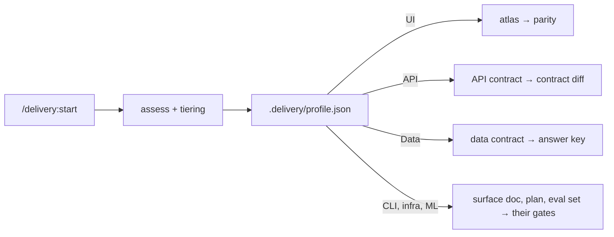

# Pilot guide

How a team tries the delivery plugin for three weeks and decides, with numbers, whether to keep it.
Read [README.md](README.md) for what the plugin is and [FRAMEWORK.md](FRAMEWORK.md) for the phases.

## Step 0: assess

Every pilot starts with `/delivery:start`, which assesses the repo before anything runs. The profile
decides which contract plays the atlas's role and which gate plays parity's role, so a data or
backend pilot never draws screens:

| Surface | Contract artefact | Verification gate | E2E / integration |
| --- | --- | --- | --- |
| UI | Mockup atlas | Screenshot parity, independent reviewer | Device or browser E2E on staging |
| API / service | OpenAPI, AsyncAPI or protobuf + sequences | Contract and consumer-driven tests, contract diff | API tests, ephemeral or staging env |
| Data / pipeline | Data contract + golden dataset with answer key | Output equals the answer key; quality checks; reproducible | Pipeline run on the golden dataset |
| CLI / library | Public API surface + usage examples | Doctests, golden CLI output, semver check | Golden CLI runs |
| Infra | Architecture diagram + IaC plan | Plan diff, policy checks (plan only) | Plan against a sandbox |
| ML / model | Eval set + answer key + decision rule | Scores meet the rule on named hardware | Eval harness |

A mixed project (a UI app with its own backend) runs both rows.

## 1. Goals and success metrics

The pilot answers one question: **does the framework ship correct work faster, with less rework,
without weakening any guard?** Decide the thresholds before week 1 and write them in `pilot/LOG.md`.

| Metric | Definition | How to measure | Suggested bar to continue |
| --- | --- | --- | --- |
| Cycle time | Ticket *In Progress* → PR ready for review | Tracker timestamps | Equal to or better than the team's last comparable work |
| Rework rate | Sessions that needed a re-entry (13c) or a second PR to finish | Count in the log | ≤ 1 in 3 sessions |
| Verification first-pass rate | Verification files (parity, contract diff, answer key) with no Open row after the first review | `design/parity/*.md`, `verification/*.md` | ≥ 50% by week 2 |
| Human-fix rate on PRs | PRs where a person had to change code before merge, and the lines they changed | PR history | Falling week on week |
| Sessions within one context | Sessions that finished without a HANDOFF to a second context | Count in the log | ≥ 70% |
| Guard incidents | A commit, push, `.env` write or production command that got past a guard | Log; should be zero | 0 |

Record evidence, not impressions: every number links to a ticket, a PR or a file.

## 2. Choose the pilot project and slice

- **A brownfield app the team knows**, with a staging environment and a way to load synthetic data.
- **Two or three low-risk, well-specified sessions**: one slice of one feature, no auth, payment or
  encryption changes, no backend change without a client fallback. Tier M is the usual fit; one
  tier-S ticket is a good warm-up.
- **If you can, run two pilots side by side: one UI project and one data or backend project.** The
  framework adapts by surface (Step 0, assess). Piloting only a UI app leaves the contract-diff and
  answer-key gates untested, and those are where non-UI teams will judge it.
- Avoid: a deadline-critical release, a regulated or sensitive-data slice (unless the pilot is
  specifically about those guards), a repo with no tests at all (add a harness first, as its own
  ticket).

## 3. Prerequisites

| Item | Check |
| --- | --- |
| Claude Code | `claude --version`; this release was built and validated on 2.1.285 |
| The plugin | `/plugin marketplace add arunma/delivery-framework`, then `/plugin install delivery@delivery-framework`; `/delivery:` autocompletes |
| Python 3.9+ | The tools and hooks are standard library only |
| graphify and archify | Read, then run, `tools/setup-tools.sh` from the plugin (installs globally). Optional for the first week; sessions report NOT RUN without them |
| Mermaid CLI | `mmdc --version` (diagram checks) |
| spec-kit | For tier M and L specs and plans |
| Tracker credentials | `JIRA_SITE`, `JIRA_USER`, `JIRA_TOKEN` in the project's gitignored `.env`; `git check-ignore .env` prints `.env`. Never pasted into a chat or a ticket |
| Staging only, synthetic data only | A staging environment and synthetic accounts (for example a `+test@` pattern the E2E wrapper enforces). No production URL, flavor or credential on any pilot machine or CI runner; set `prod_guard` patterns in `.delivery/guards.json` |
| Devices | UI: a simulator or emulator, or a device farm, for E2E and captures. Data: a local or ephemeral warehouse (for example DuckDB). API: an ephemeral or staging environment |
| CI (week 2) | Repository admin to install the Claude GitHub App and add `ANTHROPIC_API_KEY`; branch protection on the default branch |

## 4. Roles

| Role | In the pilot |
| --- | --- |
| **Owner** (one person) | Confirms the profile, answers open questions, approves the contract, commits and merges, makes the go/no-go call |
| **Engineer** (one or two) | Runs `/delivery:start` and the sessions, reads every report, keeps `pilot/LOG.md` |
| **Reviewer** (a person not running the sessions) | Reviews PRs as for any change, records human fixes, spot-checks one verification file per session against the contract |

## 5. Week by week

### Week 0: set up and dry runs

1. Install the plugin and check that `/delivery:` autocompletes its commands.
2. In the pilot repo: `/delivery:start`. Check the surfaces it detected against what you know; correct
   them. Confirm tier M for the pilot slice. Review `.delivery/PROFILE.md` with the owner.
3. Check the guards: ask the agent to `git commit`; it must be blocked with the approval message.
   Ask it to `cat .env`; it must ask first. Add your production patterns to
   `.delivery/guards.json` and confirm one is caught.
4. Run the slice's contract step (`delivery:atlas` for UI, `delivery:contract` otherwise) for just
   the pilot slice, then `delivery:specify-from-atlas`, `delivery:verify-specs` and
   `delivery:plan-and-tasks`. Owner approves.
5. Dry runs: `python3 tools/create_tickets.py --dry-run …` (via `delivery:jira-sync`),
   `sessionize.py validate`. Fix anything they report.
6. Copy [templates/pilot-LOG.md](templates/pilot-LOG.md) to `pilot/LOG.md`; record the baseline
   numbers for comparable past work.

### Week 1: interactive sessions

1. One session per day at most, each in a **fresh** Claude Code session: `/delivery:session <ID>`.
2. Read the report against [CHECKLIST.md](CHECKLIST.md) §13 before anything else. Missing evidence →
   re-entry prompt, and count it as rework.
3. The owner commits (`touch .delivery/APPROVED`, then commit, or commit from their own shell) and opens
   the PR. The reviewer reviews it as usual.
4. Log every session the same day (section 7).

### Week 2: CI-driven sessions

1. Copy [ci/github-actions/delivery-session.yml](ci/github-actions/delivery-session.yml) into the pilot
   repo, read it, adapt the allowed tools, and run it once with `workflow_dispatch` on the smallest
   remaining session.
2. Then let tickets drive: an issue titled `<SESSION-ID> · … · <KEY>` labelled `delivery:ready`
   produces a draft PR. UI device flows cannot run on a Linux runner; they show NOT RUN and need a
   local run before the PR is ready.
3. Compare with week 1: cycle time, human fixes, first-pass rate.

### Week 3: review and decide

1. `/delivery:close-wave 1` for the pilot slice: re-run everything, sweep verification, the real
   not-done list, the learning loop.
2. Fill the go/no-go checklist (section 9) with the owner, the engineers and the reviewer.
3. Carry generic lessons back to the framework (CONTRIBUTING.md), anonymised.

## 6. Daily routine

1. `/delivery:status` (add `--jira` once credentials are set): what is next, what drifted.
2. Pick the next session whose dependencies are done; open a fresh session; `/delivery:session <ID>`.
3. Answer what the session asks; do not let it decide product questions.
4. Read the report; check the evidence; owner commits or sends it back with the re-entry prompt.
5. Log it. Ten minutes at the end of the day, not at the end of the week.

## 7. Measuring and recording

Keep `pilot/LOG.md` (template: [templates/pilot-LOG.md](templates/pilot-LOG.md)) in the pilot repo:
one row per session with the ticket, the tier, start and ready timestamps, contexts used, the
verification first-pass result, rework, human fixes on the PR, guard incidents and a one-line note.
Weekly, total the metrics in section 1 at the bottom of the log.

## 8. Known failure modes and fixes

These are from the case study ([examples/case-study-mobile-vault.md](examples/case-study-mobile-vault.md))
and from running the framework since.

| Symptom | Cause | Fix |
| --- | --- | --- |
| E2E fails with selector errors that look like wrong ids | A screen-protection feature hides the accessibility tree from UI automation | A staging-only capture switch, a no-op in production and pinned by a test. Never weaken the protection |
| The E2E flow types `undefined` into a field | Some E2E tools ignore exported shell variables | Pass credentials with `-e` through `tools/maestro/e2e.sh` |
| Untracked specs or mockups overwritten | An agent rewrote files with no git history | Back up before every change; the skills do it first |
| Parallel planning agents step on each other | Shared files and branch-switching setup scripts | `plan-writer` writes only its own spec folder; one main session merges; check `git status` after |
| Every "Blocks" link is backwards | The tracker's link payload is inverted | `create_tickets.py` handles it; hand-check one pair after creating links |
| Links go to the wrong screen | Two atlas ids share a prefix | `build_atlas.py --strict` fails on ambiguous prefixes |
| Different screens show different facts | Parts invent their own seed data | One facts block in the kit; screens never inline a fact |
| "Done" with nothing pasted | The session summarised instead of proving | Reject the report; re-entry prompt; count it as rework |
| The session ran out of context | The block's slice was too big | Stop at a task boundary, HANDOFF.md, split the session next time |
| An agent "approved to push" commits | Approval of the work was read as approval to commit | The git guard blocks it; the owner approves each commit |
| A data pipeline's tests pass on a changed answer key | The key was regenerated to make a test pass | The answer key changes only with the contract, reviewed like a contract change |

## 9. Go / no-go checklist and rollback

Go, if all of these hold:
- [ ] The metric bars written in week 0 were met, or missed for a reason that is fixed.
- [ ] Zero guard incidents.
- [ ] Every merged PR had a verification file with no Open row and pasted test evidence.
- [ ] The reviewer would accept the same process on the next feature.
- [ ] At least one non-UI surface was piloted, or the decision is explicitly limited to UI work.

No-go, or partial: keep what helped (often the contract-first rule, the guards and the verification
round) and drop the rest by tier: run tier S for everything until the team chooses otherwise.

**Rollback** (nothing in the plugin is irreversible):
1. `claude plugin disable delivery@delivery-framework` (or uninstall). Hooks stop at once.
2. Delete the project's `.delivery/` folder, or keep `profile.json` for the record.
3. Remove `.github/workflows/delivery-session.yml` and the Actions secrets it used.
4. Documents the pilot produced (contracts, specs, plans) stay in the repo as ordinary docs.
