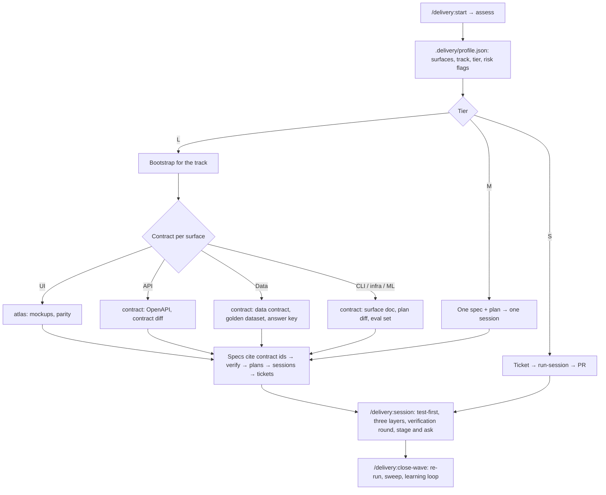
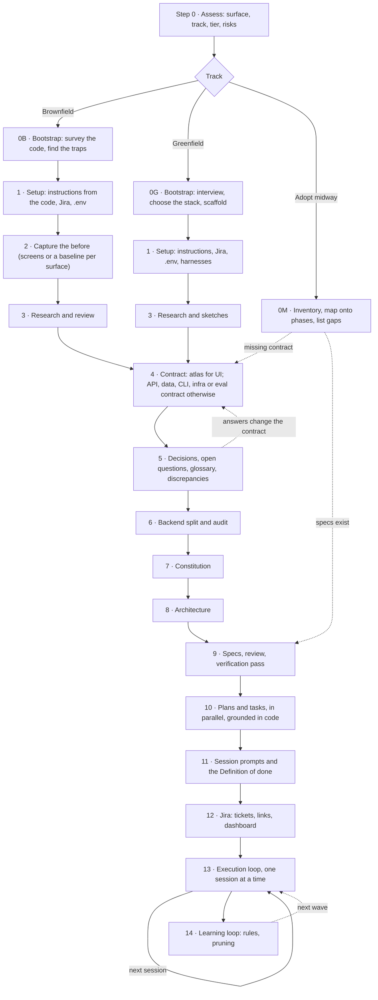

# Delivery framework

A step-by-step way to take a product from "what we have" or "what we want" to shipped code with AI
coding agents doing most of the writing, packaged as a **Claude Code plugin** (`delivery`). It is
distilled from real projects: a UI revamp of an existing mobile app (brownfield, see
[examples/case-study-mobile-vault.md](examples/case-study-mobile-vault.md)) and a new desktop product
(greenfield).

The idea in one paragraph: **assess what kind of project it is, write the contract before the spec,
write every spec before planning, plan against the real code, and cut the work into sessions that
each fit one agent context.** The contract is the mockup atlas for a UI, the API contract for a
service, the data contract and golden dataset for a pipeline, and so on. Every session proves it is
done with pasted test output and an independent check against the contract. Nothing is committed
without the owner. Every disagreement between documents is written down and stops the work.

## Install

In Claude Code (version 2.1.285 was used to build and validate this release):

```
/plugin marketplace add arunma/delivery-framework
/plugin install delivery@delivery-framework
```

or from a shell:

```bash
claude plugin marketplace add arunma/delivery-framework
claude plugin install delivery@delivery-framework
```

To try it from a clone without installing: `claude --plugin-dir /path/to/delivery-framework`.
Check a change with `claude plugin validate .` and `python3 -m unittest discover -s tests`.

The plugin needs Python 3.9+ (standard library only) for its tools and hooks. Optional, per phase:
[`uv`](https://docs.astral.sh/uv/) and Playwright for the atlas, graphify and archify
(`tools/setup-tools.sh`, which installs globally; read it first), spec-kit, Mermaid CLI, and your E2E
tool.

## Quick start

**Step 0, every project:** `/delivery:start` assesses the repo (surface, track, tier, risk flags),
writes `.delivery/profile.json` and `.delivery/PROFILE.md`, and names the next step. It also copies
`templates/guards.json` to `.delivery/guards.json`, which turns the guard hooks on for this project.

**Brownfield** (an existing codebase), tier L:
1. `/delivery:start brownfield L`, then answer its questions.
2. Run `delivery:bootstrap-brownfield` (it backs up untracked docs and builds the code graph first).
3. Follow the phases the profile has on: capture the before, the contract (`delivery:atlas` for UI,
   `delivery:contract` otherwise), decisions, backend split, constitution, architecture, specs,
   verification, plans, sessions, tickets.
4. Run sessions one at a time in fresh contexts: `/delivery:session S01`. Read the report; commit
   only when satisfied (`touch .delivery/APPROVED` lets one commit through within 15 minutes).

**Greenfield** (a new repo): `/delivery:start greenfield L`; the assessment interviews you for the
surfaces, then `delivery:bootstrap-greenfield` chooses the stack with you and scaffolds the harness
each surface's gate needs. From the contract phase on, it is the same as brownfield.

**Smaller work:** tier S is ticket → test-first change → PR (`/delivery:session ABC-42`); tier M is
one spec and one plan, then one session. `delivery:tiering` decides.

## Step 0: assess, then the per-surface path

| Surface | Contract artefact (the atlas's role) | Verification gate (parity's role) | E2E / integration |
| --- | --- | --- | --- |
| UI (mobile, web, desktop) | Mockup atlas, `design/atlas/` | Screenshot parity by an independent reviewer | Maestro, XCUITest, Espresso, Playwright on staging |
| API / service | OpenAPI, AsyncAPI or protobuf + sequence diagrams | Contract and consumer-driven tests, contract diff | API tests on an ephemeral or staging environment |
| Data / pipeline | Data contract: schemas, dictionary, lineage, SLAs, freshness | Output equals the committed answer key; quality checks; reproducible run | Pipeline run on the golden dataset (synthetic) |
| CLI / library | Public API surface + usage examples | Doctests, golden CLI output, semver check | Golden CLI runs |
| Infra | Architecture diagram + IaC plan | Plan diff and policy checks (plan only in a pilot) | Plan against a sandbox account |
| ML / model | Eval set + answer key + decision rule | Scores meet the rule on named hardware | Eval harness on benchmark hardware |

A mixed project combines rows: a UI app with its own backend has an atlas and an API contract, and
its sessions run both gates. Templates: [templates/contracts/](templates/contracts/).



## Phase map

The tracks differ up to phase 3 and merge at the contract (phase 4). Phases the profile turns off are
skipped; swapped phases use the surface's contract and gate.



## Commands

| Command | What it does |
| --- | --- |
| `/delivery:start [track] [tier]` | Assess the project (if needed), confirm track and tier, name the next step |
| `/delivery:assess [repo] [--tier]` | The `assess` skill: classify and write `.delivery/profile.json` and `PROFILE.md` |
| `/delivery:session <SESSION-ID or TICKET-KEY> [--ci]` | Run one session or one tier-S ticket through the execution loop, ending staged |
| `/delivery:parity <spec>` | The independent verification round for one spec |
| `/delivery:status [--jira]` | Tasks done per session, ticket status, and the drift between them |
| `/delivery:close-wave <n>` | Close a wave: re-run everything, sweep, not-done list, seams, learning loop |

Every skill can also be run by name, for example `/delivery:sessionize` or `/delivery:jira-sync`.

**Skills (20):** `assess`, `tiering`, `bootstrap-brownfield`, `bootstrap-greenfield`, `adopt-midway`,
`capture-before`, `atlas`, `contract`, `decisions`, `backend-split`, `constitution`, `architecture`,
`specify-from-atlas`, `verify-specs`, `plan-and-tasks`, `sessionize`, `jira-sync`, `run-session`,
`parity-review`, `wave-close`. Each reads the profile first and stops if its phase is off.

**Agents (5):** `parity-reviewer` (independent; no shell, never sees the diff; writes the verification
file), `design-reviewer`, `spec-verifier`, `backend-auditor` (read-only tools, file:line evidence),
`plan-writer` (one spec folder per agent; see the note on write limits below).

## Hooks

All hooks are **no-ops unless the project has a `.delivery/` directory** (created by
`/delivery:start` or `/delivery:assess`), so installing the plugin does not change other repos. Each
is configured in `.delivery/guards.json` ([template](templates/guards.json)).

| Hook | Event and matcher | What it does | Default |
| --- | --- | --- | --- |
| `guard_git.py` | PreToolUse, `Bash` | Blocks `git commit` and `git push` (exit 2, with the reason) unless the owner created `.delivery/APPROVED` within `approval_ttl_minutes` (15) or `DELIVERY_ALLOW_GIT=1` is set | on |
| `guard_secrets.py` | PreToolUse, `Write\|Edit` and `Bash` | Blocks writing `.env*` (not `.env.example`) and the approval file; asks before commands that print `.env` or token variables (`read_mode`: ask, warn or block) | on |
| `guard_prod.py` | PreToolUse, `Bash` | Asks, warns or blocks when a command matches a production pattern you list (flavor, URL) | off until patterns are set |
| `session_start.py` | SessionStart | Adds the profile summary, the restart doc (`ARCHITECTURE-PROMPT.md` or `docs/RESTART.md`) and the code graph's freshness to context | on |

The guards are guard rails for agents, not a security boundary: a person with a shell can do
anything. Frontmatter cannot limit an agent's writes to one folder, so `plan-writer`'s folder rule is
in its prompt and checked afterwards with `git status`.

## Tools

| Tool | Used for |
| --- | --- |
| `tools/assess.py` | Detect surfaces, track and risk flags; write the profile and phase switches |
| `tools/sessionize.py` | Generate SESSIONS.md blocks from tasks.md phases; validate blocks; report status drift |
| `tools/jira.py`, `create_tickets.py`, `jira_dashboard.py` | Move tickets with evidence; create tickets and links (correct direction); filters and dashboard |
| `tools/atlas-starter/` | The mockup atlas generator (UI contract) |
| `tools/maestro/` | E2E wrapper that passes credentials with `-e` and refuses non-synthetic accounts; capture flow |
| `tools/setup-tools.sh` | Install graphify and archify (global; read it first) |

External: [spec-kit](https://github.com/github/spec-kit) (specs, plans, tasks),
[graphify](https://github.com/Graphify-Labs/graphify) (code graph),
[archify](https://github.com/tt-a1i/archify) and [Mermaid](https://mermaid.js.org/) (diagrams), your
E2E or integration tools, and Jira for the progress record.

## CI pilot

[ci/github-actions/](ci/github-actions/) has an **example** workflow for the pilot: an issue labelled
`delivery:ready` (or a manual run with a session id) runs the session headless with
`anthropics/claude-code-action` on a branch named after the ticket and opens a draft pull request.
Read its README before using it. Never run it on a production configuration.

## Files

| File | What it is |
| --- | --- |
| [FRAMEWORK.md](FRAMEWORK.md) | The full guide: each phase's purpose, outputs, prompt, skill, gate and pitfalls |
| [CHECKLIST.md](CHECKLIST.md) | The gates, with the command per gate |
| [PILOT.md](PILOT.md) | A step-by-step guide for a team's first pilot |
| [docs/learning/claude-code-plugins.md](docs/learning/claude-code-plugins.md) | A learning guide to Claude Code plugins, with this plugin as the worked example |
| [templates/](templates/) | Starting files: instructions, constitution, decisions, sessions, tasks, contracts, guards |
| [prompts/](prompts/) | The agent prompts, one file per phase; the skills run them |
| [skills/](skills/), [commands/](commands/), [agents/](agents/), [hooks/](hooks/) | The plugin |
| [reference/CONVENTIONS.md](reference/CONVENTIONS.md) | The rules every skill follows (profile first, guards, evidence) |
| [tools/](tools/) | Scripts the skills call; fixtures in `tools/samples/` |
| [tests/](tests/) | Unit tests for the hooks, `assess.py` and `sessionize.py` |
| [examples/](examples/) | An anonymised brownfield case study |
| [CHANGELOG.md](CHANGELOG.md), [CONTRIBUTING.md](CONTRIBUTING.md), [AGENTS.md](AGENTS.md) | History, how to change the framework, rules for agents working on this repo |

## Who does what

| | Owner | Engineer | Agent | Reviewer agent |
| --- | --- | --- | --- | --- |
| 0 Assess | Confirms surfaces, tier and risks | Runs `/delivery:start` | Detects and drafts the profile | — |
| 0–1 Bootstrap, setup | Answers the interview; creates the tracker and token | Checks the gate | Surveys or scaffolds; writes instructions | — |
| 2–4 Before, research, contract | Approves the contract | Runs part agents in parallel | Captures the baseline; builds the contract | Design review rounds |
| 5 Decisions | **Decides** | Chases answers | Drafts questions with recommendations; applies answers | — |
| 6–10 Backend, constitution, architecture, specs, plans | Chooses non-negotiables; answers *For the owner* | Runs spec and plan agents in parallel | Writes; verification pass | Spec reviews |
| 11–12 Sessions, tracker | Reviews the order | Runs the ticket tools | Writes blocks; creates tickets | — |
| 13 Execution | **Commits and merges** | Runs one session per fresh context; reads reports | Implements, tests, moves its ticket | Verification round |
| 14 Learning | Approves rule changes | Raises misses | Proposes rules, prunes | — |

## License

MIT (see [LICENSE](LICENSE)).
