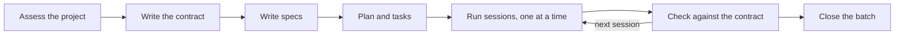

# Delivery framework

A Claude Code plugin (`delivery`) for delivering a project with AI coding agents.

## Install

```
/plugin marketplace add arunma/delivery-framework
/plugin install delivery@delivery-framework
```

The same works from a shell as `claude plugin …`; to try a clone, `claude --plugin-dir <path>`.
Needs Python 3.9+ (standard library only). Built and checked on Claude Code 2.1.285.

## What it does

It helps a team deliver a project with Claude Code. First it works out what kind of project you have.
Then it writes down what "done" looks like, which we call the **contract**, and breaks the work into
small **sessions** that an AI agent can finish one at a time. Every result is checked against the
contract, and the tracker (Jira) is kept up to date as you go. People decide and review; the agent
does the work, and it never commits for you.

## How it does it



The **contract** depends on what you're building: clickable mockups of every screen for an app, an
API contract (OpenAPI) for a service, a data contract plus a small known dataset with its expected
output for a data pipeline, and so on. Every spec points at the part of the contract it builds.

How much of this runs depends on the size of the work. A **small** project (one ticket) goes straight
to a PR. A **medium** one gets a short spec and plan first. A **large** one gets the full flow above:
contract, specs, plans and sessions in batches.

| Command | What it does |
| --- | --- |
| `/delivery:start` | Look at the project, ask what it can't tell, and say what to run next |
| `/delivery:assess` | Just the look: what you're building, existing or new, size, risks |
| `/delivery:session <id>` | Run one session (or one small ticket): tests first, build, check, stage the work for you |
| `/delivery:parity <spec>` | Check the result matches the contract: screenshots for apps, contract tests for APIs, expected outputs for data |
| `/delivery:status` | Show what is done, what is next, and where the tracker disagrees with the work |
| `/delivery:close-wave <n>` | Close a batch ("wave") of sessions: re-run every check, list what is really not done, turn mistakes into rules |

Every step also has its own command, such as `/delivery:contract` or `/delivery:sessionize`; see
[FRAMEWORK.md](FRAMEWORK.md). Guard hooks stop the agent committing, pushing or touching your
secrets; they only switch on in projects where you ran `/delivery:start`.

## How to use it

### Example 1: an existing web app with an API

You have a web front end and the API behind it, and you want to rebuild a few screens.

```
/delivery:start brownfield
```

The plugin scans the repo and asks you to confirm what it found. A short summary looks like this
(example):

```
What you're building: web UI (React) + API (OpenAPI found)
Project: existing code · Size: large · Risks: UI depends on the backend
Contract: clickable mockups for the UI, the OpenAPI file for the API
Check: screenshots against the mockups; contract tests for the API
Next: /delivery:bootstrap-brownfield
```

It writes `.delivery/profile.json`, a readable `.delivery/PROFILE.md`, and `.delivery/guards.json`
(which turns the guards on). Then you work down the steps `PROFILE.md` lists, approving each one
(the main ones are shown here):

```
/delivery:bootstrap-brownfield   # reads the code, writes CLAUDE.md, ARCHITECTURE.md, open questions
/delivery:atlas                  # clickable mockups of every screen
/delivery:contract api           # the API contract
/delivery:specify-from-atlas     # one spec per feature, citing screen and operation ids
/delivery:plan-and-tasks         # a plan per spec, tasks grouped by session
/delivery:sessionize             # SESSIONS.md: one ready-to-run prompt per session
/delivery:jira-sync              # one ticket per session
```

Then run the first session in a fresh Claude Code session:

```
/delivery:session signin-screen
```

It writes failing tests, makes them pass, runs the end-to-end flows, has an independent reviewer
compare screenshots with the mockups, stages the work and stops. Its report ends like this (example):

```
signin-screen · Rebuild the sign-in screen · PROJ-12
Tests: unit 42 passed · widget 18 passed · E2E 3 passed, 1 NOT RUN (no device)
Check: design/parity/003.md, 0 open differences
Staged: 9 files · proposed commit "PROJ-12: rebuild the sign-in screen"
```

You review and commit it yourself: one commit per session on the batch's branch, pushed once when
the batch closes (`RUN-SHEET.md` lists every command). Or run `touch .delivery/APPROVED`: the agent
may then commit and push for the next 15 minutes. Delete the file as soon as it has.

```bash
git diff --staged
git commit -m "PROJ-12: rebuild the sign-in screen"
```

### Example 2: a new data pipeline, no UI

```
/delivery:start greenfield
```

There is no code to scan, so it asks a few questions: what the product is, who uses it, what you're
building (here, a data pipeline only), and whether it touches sensitive or regulated data. The
profile then says there are no screens to draw. Instead the contract is a **data contract** (tables,
columns, meanings, freshness) plus a **golden dataset**: a small synthetic input with the exact output
it must produce, which acts as the answer key.

```
/delivery:bootstrap-greenfield   # agree the stack with you, scaffold the repo
/delivery:contract data          # contracts/data/orders.md, the golden dataset and its answer key
```

Specs, plans and sessions follow as in example 1. A session runs the pipeline on the golden dataset
and compares its output with the answer key, row by row. It also runs the data-quality checks and a
second run to show the output is reproducible. The result goes in `verification/NNN.md` (example):

```
Answer key: 1,204 / 1,204 rows match · Quality checks: 12 passed · Re-run: identical
```

The answer key only changes when the contract changes, never to make a test pass.

## More

| File | What it is |
| --- | --- |
| [FRAMEWORK.md](FRAMEWORK.md) | Each step: what it's for, what you run, what you get, when it's done |
| [CHECKLIST.md](CHECKLIST.md) | A short checklist per step |
| [PILOT.md](PILOT.md) | How a team tries the plugin for three weeks and decides |
| [examples/](examples/) | An anonymised case study |
| [CONTRIBUTING.md](CONTRIBUTING.md), [CHANGELOG.md](CHANGELOG.md) | How to change the framework (and check it); history |

## License

MIT (see [LICENSE](LICENSE)).
