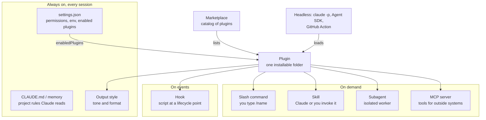
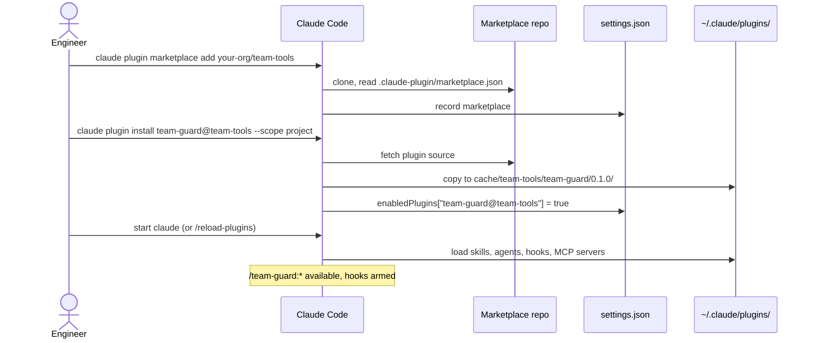
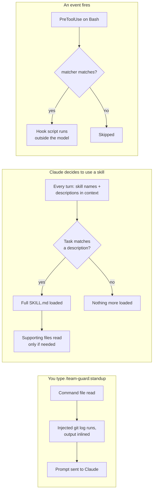
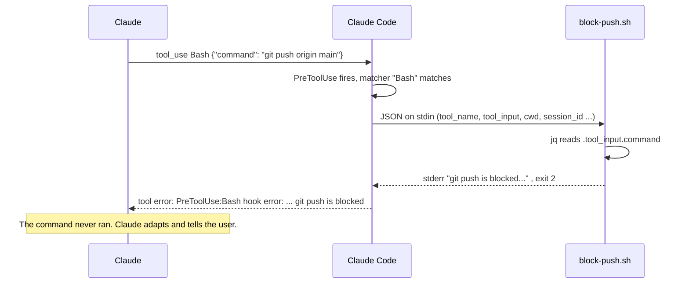
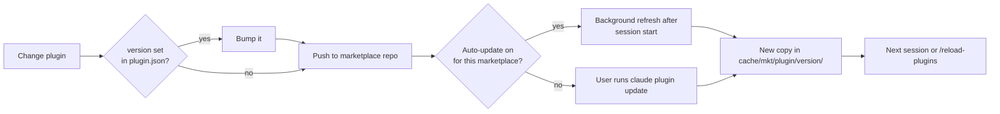
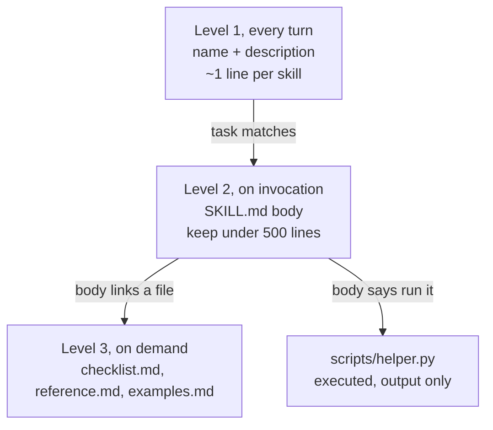
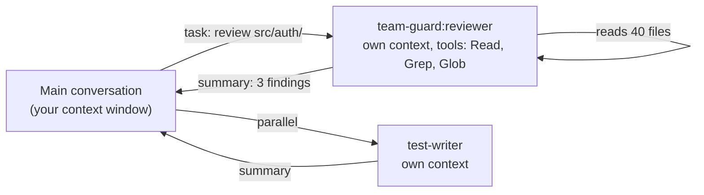
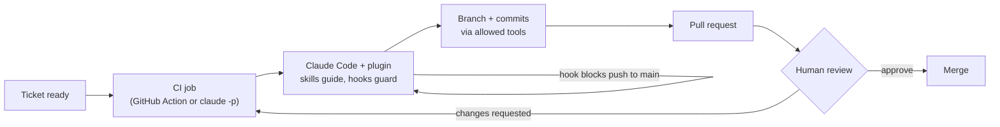
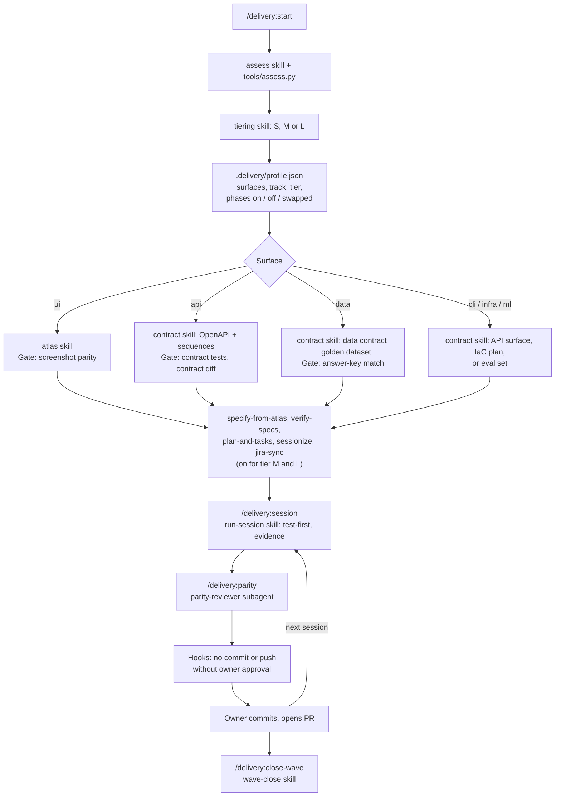

# Claude Code plugins, from zero

A guide for engineering leaders who know what an agentic coding tool is but have never opened a
Claude Code plugin. It explains what each extension point does, how a plugin packages them, how a
team distributes one, and how the same plugin runs in CI with no person at the keyboard. Every
command, field and event name below comes from the official docs listed under [Sources](#sources).
They were checked against Claude Code 2.1.285.

---

## 1. The idea in one paragraph

**A plugin is a folder that adds capabilities to Claude Code and installs as one unit.** It can hold
skills (instructions Claude loads when relevant), commands, subagents, hooks (scripts that run at
fixed points in a session), MCP servers (connections to outside systems) and output styles.
Without a plugin, each of these lives in a different place in a repo's `.claude/` folder or your
home directory, and each engineer copies them by hand. With a plugin, a team writes its way of
working once, publishes it in a **marketplace** (a catalog file in a git repo), and every engineer,
repository and CI job installs the same version with one command.

---

## 2. Where plugins fit

Claude Code has several extension points. Some are always-on context, some run on demand, some run
on events. A plugin is the packaging layer around most of them. A marketplace is how plugins travel.



Terms, once each:

- **CLAUDE.md**: standing instructions loaded every session (`./CLAUDE.md`, `~/.claude/CLAUDE.md`).
  Context, not enforcement.
- **Settings**: JSON config at user (`~/.claude/settings.json`), project (`.claude/settings.json`,
  committed) and local (`.claude/settings.local.json`) scope, plus organization-managed settings
  that override all three. Permission rules such as `"deny": ["Bash(git push *)"]` live here.
- **Slash command**: a Markdown prompt run as `/name`. Commands are now merged into skills.
- **Skill**: a folder with a `SKILL.md`. Claude loads it when a task matches its `description`
  (*model-invoked*), or you type it (*user-invoked*). Frontmatter decides which is allowed.
- **Subagent**: a separate assistant with its own prompt, tools and context; returns a summary.
- **Hook**: a command Claude Code runs at an event such as `PreToolUse`, whatever Claude intends.
- **MCP server**: a process or URL speaking the Model Context Protocol; gives Claude new tools.
- **Output style**: instructions that set Claude's role, tone and format for a session.
- **Headless**: Claude Code with no terminal UI: `claude -p`, the Agent SDK, the GitHub Action.

### Which one do I use?

| Use | When | One-line example |
| --- | --- | --- |
| `CLAUDE.md` | Claude should always know it | "Use pnpm, not npm. Tests: `pnpm test`." |
| Permission rule | A tool call should never or always be allowed, by pattern | `"deny": ["Bash(git push *)"]` in settings |
| Hook | Something must happen every time, deterministically | `PreToolUse` script that exits 2 on `git push` |
| Skill (model-invoked) | Knowledge or a procedure Claude should apply when relevant | `review-diff`: checklist Claude follows when asked for a review |
| Skill / command (user-invoked) | A workflow you start by name, often with side effects | `/deploy staging` with `disable-model-invocation: true` |
| Subagent | Work that reads a lot but should return a little, or needs a second opinion | Read-only `reviewer` that cannot edit files |
| MCP server | Claude needs tools or data from another system | A tracker MCP server to read and update tickets |
| Output style | Every response should sound or look different | A terse style for incident channels |
| Plugin | A second repo or a second person needs the same setup | `team-guard` bundling all of the above |
| Headless | No person is present | Nightly `claude -p` job, or the GitHub Action on every PR |

The docs put the key distinction plainly: an instruction in CLAUDE.md or a skill is a request; a
`PreToolUse` hook that blocks the call is enforcement.

---

## 3. Anatomy of a plugin

### The layout

Only `plugin.json` goes inside `.claude-plugin/`. Everything else sits at the plugin root.

```text
team-guard/
├── .claude-plugin/
│   └── plugin.json          # manifest: name, version, description
├── commands/
│   └── standup.md           # /team-guard:standup
├── skills/
│   └── review-diff/
│       ├── SKILL.md         # /team-guard:review-diff, and Claude can auto-load it
│       └── checklist.md     # supporting file, read only when needed
├── agents/
│   └── reviewer.md          # subagent team-guard:reviewer
├── hooks/
│   └── hooks.json           # hook config, same shape as "hooks" in settings.json
└── scripts/
    └── block-push.sh        # called by the hook
```

Other default locations a plugin can use: `.mcp.json` (MCP servers), `.lsp.json` (language
servers), `output-styles/` (output styles), `bin/` (executables put on the Bash tool's `PATH`),
`settings.json` (only the `agent` and `subagentStatusLine` keys take effect). A `CLAUDE.md` at the
plugin root is **not** loaded; put instructions in a skill.

### `plugin.json`

Only `name` is required. It becomes the namespace: every skill, command and agent is prefixed with
it, so two plugins can each ship a `review` skill without colliding.

```json
{
  "name": "team-guard",
  "version": "0.1.0",
  "description": "Team guardrails: a standup command, a diff-review skill, a read-only reviewer and a push guard",
  "author": { "name": "Platform team" },
  "license": "MIT"
}
```

| Field | What it does |
| --- | --- |
| `name` | Required. Kebab-case. Prefix for every component (`team-guard:reviewer`). Names starting with `claude-` or `anthropic-` are rejected |
| `version` | Pins users to this version until you change it. Omit it and users track commits instead |
| `description`, `author`, `license`, `keywords`, `homepage`, `repository` | Metadata shown in `/plugin` |
| `skills`, `commands`, `agents`, `hooks`, `mcpServers`, `outputStyles` | Point at non-default locations or define inline. `skills` adds to `skills/`; `commands` and `agents` replace their default folders |
| `userConfig` | Values Claude Code prompts for when the plugin is enabled; `"sensitive": true` stores them in the OS credential store |

### The four component files

**Command** (`commands/standup.md`). A user-invoked prompt. The `` !`…` `` line runs before Claude
sees the prompt and is replaced by its output.

```markdown
---
description: Summarise my commits since yesterday as a standup update
allowed-tools: Bash(git log *)
---

## My recent commits

!`git log --since=yesterday --oneline`

## Task

Write a three-line standup: done, next, blocked. Use only the commits above.
If there are none, say so.
```

**Skill** (`skills/review-diff/SKILL.md`). No `disable-model-invocation`, so Claude may load it on
its own when the description matches.

```markdown
---
name: review-diff
description: Reviews the uncommitted diff against the team checklist. Use when the user asks for a review, asks whether a change is ready, or is about to open a pull request.
argument-hint: "[base-branch]"
allowed-tools: Bash(git diff *) Read Grep Glob
---

1. Run `git diff HEAD` to see the change. If a base branch is given (`$ARGUMENTS`), run
   `git diff $ARGUMENTS...HEAD` instead.
2. Check it against [checklist.md](checklist.md).
3. Report findings as `file:line - problem - fix`, most severe first.
4. For a change over 300 lines, delegate the read to the `team-guard:reviewer` subagent.
```

**Subagent** (`agents/reviewer.md`). `tools` is an allowlist, so this reviewer cannot write.

```markdown
---
name: reviewer
description: Independent read-only reviewer. Use for large diffs or when a second opinion is wanted.
tools: Read, Grep, Glob
model: sonnet
---

You are a code reviewer who did not write this change. Read the files you are given,
then list concrete problems with file and line. Do not suggest style-only edits.
You cannot edit files; report only.
```

**Hook** (`hooks/hooks.json` plus a script). `${CLAUDE_PLUGIN_ROOT}` resolves to the plugin's
installed directory; quote it in shell-form commands so a path with spaces stays one word.

```json
{
  "hooks": {
    "PreToolUse": [
      {
        "matcher": "Bash",
        "hooks": [
          { "type": "command", "command": "\"${CLAUDE_PLUGIN_ROOT}/scripts/block-push.sh\"" }
        ]
      }
    ]
  }
}
```

```bash
#!/bin/bash
# PreToolUse(Bash): refuse `git push`. Input is JSON on stdin.
cmd=$(jq -r '.tool_input.command // ""')

if [[ "$cmd" =~ (^|[[:space:];&|])git[[:space:]]+push ]]; then
  echo "team-guard: git push is blocked. Show the user the branch and let them push." >&2
  exit 2
fi
exit 0
```

Three path variables are available to plugin components:

| Variable | Points at | Use for |
| --- | --- | --- |
| `${CLAUDE_PLUGIN_ROOT}` | The installed version's directory (changes on update) | Bundled scripts and config |
| `${CLAUDE_PLUGIN_DATA}` | `~/.claude/plugins/data/<id>/`, kept across updates | Caches, installed dependencies, state |
| `${CLAUDE_PROJECT_DIR}` | The project root | Project-local files |

---

## 4. Lifecycles

### Install: from marketplace to session



A plugin must be present at three layers before it does anything: **settings** (marketplace known,
plugin enabled), **disk** (fetched into `~/.claude/plugins/`), and **session** (loaded at startup
or by `/reload-plugins`).

### Three ways a plugin acts



The first is explicit, the second is a judgement Claude makes, the third involves no judgement at
all. That difference is why guardrails belong in hooks.

### A hook blocking a tool call



---

## 5. Hands-on in 15 minutes

You need Claude Code installed and signed in, plus `jq`. These steps were run as written.

**1. Create the files.** Make the tree from section 3 and paste in the six file bodies. Then:

```bash
chmod +x team-guard/scripts/block-push.sh
```

**2. Validate.**

```bash
claude plugin validate ./team-guard
```

```text
Validating plugin manifest: .../team-guard/.claude-plugin/plugin.json

✔ Validation passed
```

**3. Test the hook script on its own.** Hooks are plain programs; test them like any other.

```bash
echo '{"tool_name":"Bash","tool_input":{"command":"git push origin main"}}' \
  | ./team-guard/scripts/block-push.sh; echo "exit=$?"
# team-guard: git push is blocked. Show the user the branch and let them push.
# exit=2
echo '{"tool_name":"Bash","tool_input":{"command":"git status"}}' \
  | ./team-guard/scripts/block-push.sh; echo "exit=$?"
# exit=0
```

**4. Load the plugin for one session.** `--plugin-dir` is the documented way to test without a
marketplace; nothing is written to your settings. Run it inside any git repo.

```bash
cd some-git-repo
claude --plugin-dir ../team-guard
```

**5. Run the command.** Type `/team-guard:standup`. Sample output from a repo with one commit:

```text
Done: Added the login form (ea04148).
Next: Not in the commit history. Fill this in yourself.
Blocked: Nothing recorded in the commits.
```

**6. Trigger the hook.** Ask: *"Run `git push origin main`."* Claude calls Bash, the hook blocks it,
and Claude receives:

```text
PreToolUse:Bash hook error: [".../team-guard/scripts/block-push.sh"]: team-guard: git push is blocked. Show the user the branch and let them push.
```

**7. Check what loaded.** Inside the session, `/plugin` shows the plugin under **Installed** and
load failures under **Errors**. After editing a file, run `/reload-plugins`. For hook details, start
with `claude --debug` and read `~/.claude/debug/<session-id>.txt`.

The same plugin runs headless: `claude -p "/team-guard:standup" --plugin-dir ../team-guard`.

---

## 6. Distributing to a team

### The marketplace file

A marketplace is a git repo (or directory, or URL) with `.claude-plugin/marketplace.json`. It needs
`name`, `owner` and `plugins`; each entry needs `name` and `source`.

```json
{
  "name": "team-tools",
  "description": "Plugins for the platform team",
  "owner": { "name": "Platform team" },
  "plugins": [
    { "name": "team-guard", "source": "./plugins/team-guard", "description": "Push guard, diff review, standup" },
    { "name": "release-notes",
      "source": { "source": "github", "repo": "your-org/release-notes-plugin", "ref": "v1.2.0" } }
  ]
}
```

Relative sources start with `./` from the marketplace root. Other source types: `github`, `url`
(any git host), `git-subdir` (a folder in a monorepo), `archive` (a zip over HTTPS), `npm`. Keep
the entry `name` equal to the plugin's own `name`.

Check it with `claude plugin validate ./team-tools`.

### Install, update, scope

```bash
claude plugin marketplace add your-org/team-tools        # once; GitHub shorthand, #ref to pin
claude plugin install team-guard@team-tools              # user scope by default
claude plugin update team-guard@team-tools
claude plugin marketplace update team-tools              # refresh the catalog
claude plugin disable team-guard@team-tools
claude plugin list
```

Inside a session, `/plugin` opens the same manager, and `/plugin install team-guard@team-tools`
opens the plugin's details so you can review it and pick a scope.

| Scope | Enabled for | Written to |
| --- | --- | --- |
| user | You, every project | `~/.claude/settings.json` |
| project | Everyone in this repo | `.claude/settings.json` (commit it) |
| local | You, this repo only | `.claude/settings.local.json` |

When the same plugin is set at several scopes: local beats project beats user. Managed
(organization) settings beat all three.

### Make a repo bring its own plugins

Commit this to the repo's `.claude/settings.json`. After a contributor trusts the folder, Claude
Code registers the marketplace; the relative-path plugin installs from it. (A plugin whose entry
points at its own external repo still needs one `claude plugin install … --scope project` per
person.) Running `claude plugin marketplace add your-org/team-tools --scope project` writes the
first key for you.

```json
{
  "extraKnownMarketplaces": {
    "team-tools": { "source": { "source": "github", "repo": "your-org/team-tools" } }
  },
  "enabledPlugins": { "team-guard@team-tools": true }
}
```

An administrator can put the same two keys in **managed settings** to install a plugin on every
machine, add `"autoUpdate": true` to the marketplace entry, and restrict sources with
`strictKnownMarketplaces`.

### Versions and updates



- If `version` is set and you push without bumping it, **users do not receive the change**.
- Omit `version` everywhere to have users track commits.
- Don't set `version` in both `plugin.json` and the marketplace entry; `plugin.json` wins silently.
- Pin with `ref`/`sha` on a source, or `#ref` on the marketplace add command.
- Auto-update is off by default for third-party marketplaces. A user turns it on in `/plugin` →
  **Marketplaces**, or an admin sets it in managed settings.
- Renaming a plugin breaks installs; change `displayName` instead, or add a `renames` map to
  `marketplace.json`.

---

## 7. Skills, in depth

A skill is a folder whose `SKILL.md` has YAML frontmatter and a Markdown body.

| Field | Effect |
| --- | --- |
| `description` | **How Claude decides to use the skill.** Put the use case first. With `when_to_use` it is capped at 1,536 characters in the listing |
| `name` | Command name; defaults to the folder name |
| `disable-model-invocation: true` | Only you can run it. Its description leaves Claude's context. Use for anything with side effects |
| `user-invocable: false` | Only Claude can use it; hidden from the `/` menu |
| `allowed-tools` | Tools pre-approved for the turn that runs the skill, e.g. `Bash(git log *) Read` |
| `argument-hint`, `arguments` | Autocomplete hint; named `$issue`-style arguments. `$ARGUMENTS` holds everything typed |
| `context: fork`, `agent` | Run the skill in a subagent instead of the main conversation |
| `paths` | Only auto-load when working with matching files |
| `model`, `effort` | Override for the turn |

### Progressive disclosure

Skills cost almost nothing until used. Claude sees names and descriptions every turn, the body only
when the skill is invoked, and supporting files only when the body tells Claude to open them.
Scripts in the folder are executed, not loaded.



Once loaded, the body stays in the conversation and is not re-read, so write guidance that applies
for the whole task ("run the tests after every edit"), and put the most important rules near the
top: after compaction only the start of a skill may survive.

### Good and bad descriptions

| Bad | Why | Better |
| --- | --- | --- |
| `Helps with code` | Matches everything and nothing | `Reviews the uncommitted diff against the team checklist. Use when asked for a review or before opening a PR.` |
| `Jira skill` | A noun, no trigger | `Creates and updates tracker tickets from a spec. Use when the user asks to file, link or move a ticket.` |
| `Deploys the app` (model-invocable) | Claude could deploy unasked | Same text plus `disable-model-invocation: true` |
| A 40-line essay | Truncated; keywords lost | One sentence of what, one of when, using words people actually type |

If a skill doesn't trigger, check the description has the words users say, ask *"What skills are
available?"*, and run `claude plugin validate` on the folder to catch YAML that doesn't parse
(a malformed header loads the body with no description, so Claude can't match it).

---

## 8. Subagents

A subagent starts with a fresh context: its own system prompt, the task message, CLAUDE.md and git
status, and any skills listed in its `skills` field. It does **not** see the main conversation.
It returns one result.



Use one when:

- **Independent review.** The author shouldn't grade its own work. A reviewer with no memory of
  writing the code, and no write tools, gives a cleaner second opinion.
- **Context isolation.** A search that reads dozens of files returns a paragraph, not the files.
- **Parallel work.** Several subagents can run at once on separate parts of a task.

Restrict tools with an allowlist or a denylist:

```yaml
tools: Read, Grep, Glob, Bash          # allowlist: nothing else
```

```yaml
disallowedTools: Write, Edit           # denylist: everything except these
```

Invoke explicitly with `@agent-team-guard:reviewer`, or by asking ("use the reviewer agent").
Plugin agents ignore `hooks`, `mcpServers` and `permissionMode` in their frontmatter; put hooks and
MCP servers at the plugin level instead.

---

## 9. Hooks

### Events

| Event | Fires | Can block? |
| --- | --- | --- |
| `SessionStart` | Session begins or resumes | No; stdout becomes context |
| `UserPromptSubmit` | Prompt submitted, before Claude sees it | Yes |
| `UserPromptExpansion` | A typed command expands into a prompt | Yes |
| `PreToolUse` | Before a tool call | **Yes** |
| `PermissionRequest` | A tool call needs a permission decision | Decides it via JSON (exit 2 ignored) |
| `PostToolUse` / `PostToolUseFailure` | After a tool call succeeds / fails | Feeds back to Claude |
| `PostToolBatch` | After a batch of parallel tool calls | Yes (stops the loop) |
| `Notification` | Claude Code sends a notification | No |
| `SubagentStart` / `SubagentStop` | A subagent starts / finishes | `SubagentStop`: yes |
| `Stop` / `StopFailure` | Claude finishes responding / turn ends on an API error | `Stop`: yes |
| `PreCompact` / `PostCompact` | Around context compaction | `PreCompact`: yes |
| `SessionEnd` | Session terminates | No |

Also documented: `Setup`, `InstructionsLoaded`, `MessageDisplay`, `PermissionDenied`,
`TaskCreated`, `TaskCompleted`, `TeammateIdle`, `ConfigChange`, `CwdChanged`, `DirectoryAdded`,
`FileChanged`, `WorktreeCreate`, `WorktreeRemove`, `PreModelSwitch`, `PostModelSwitch`,
`Elicitation`, `ElicitationResult`.

### Matchers

The `matcher` filters by tool name for tool events (`Bash`, `Edit|Write`, `mcp__.*`), by source for
`SessionStart` (`startup`, `resume`, `clear`, `compact`, `fork`). Letters, digits, `_`, `-`, `|`
and `,` mean an exact match; anything else is an unanchored JavaScript regex, so `Edit.*` also
matches `NotebookEdit`. `"*"`, `""` or no matcher means all. A plugin's own MCP tools are named
`mcp__plugin_<plugin>_<server>__<tool>`.

### Input and output

The hook receives JSON on stdin with common fields (`session_id`, `transcript_path`, `cwd`,
`hook_event_name`, `permission_mode`) plus event fields (`tool_name`, `tool_input`, `tool_use_id`
for tool events).

| Exit code | Meaning |
| --- | --- |
| `0` | Success. If stdout is one JSON object, its fields apply. For `SessionStart` and `UserPromptSubmit`, plain stdout is added to Claude's context |
| `2` | Blocking error on events that can block. stderr is the reason Claude sees |
| anything else | Non-blocking error. The action goes ahead and a `hook error` notice shows. **`exit 1` does not block** |

For finer control, a `PreToolUse` hook exits 0 and prints a decision (`allow`, `deny`, `ask` or
`defer`):

```json
{
  "hookSpecificOutput": {
    "hookEventName": "PreToolUse",
    "permissionDecision": "ask",
    "permissionDecisionReason": "This command targets production. Confirm?"
  }
}
```

When several hooks disagree, `deny` > `defer` > `ask` > `allow`. A hook's `allow` does not override
deny rules in settings.

### Recipe 1: block risky commands

The `block-push.sh` hook from section 3. Variant: use `"permissionDecision": "ask"` instead of
`exit 2` when a human should decide rather than a flat no.

### Recipe 2: auto-format after edits

```json
{ "hooks": { "PostToolUse": [ { "matcher": "Edit|Write", "hooks": [
  { "type": "command", "command": "jq -r '.tool_input.file_path' | xargs npx prettier --write" }
] } ] } }
```

A `PostToolUse` hook that exits 0 shows nothing; confirm it ran with `claude --debug` or by its
effect.

### Recipe 3: inject context at session start

```json
{ "hooks": { "SessionStart": [ { "matcher": "startup|resume", "hooks": [
  { "type": "command", "command": "\"${CLAUDE_PLUGIN_ROOT}/scripts/context.sh\"" }
] } ] } }
```

```bash
#!/bin/bash
# Plain stdout from a SessionStart hook is added to Claude's context.
echo "Branch: $(git branch --show-current)"
echo "Open TODOs in this branch: $(git diff main --unified=0 | grep -c '^+.*TODO' || true)"
```

Keep it fast: it runs on every session start.

### Security

The docs are blunt: **command hooks execute shell commands with your full user permissions.** A
plugin's hooks are registered when the plugin loads and fire on every matching event, whether or not
you use the plugin's skills. In an interactive session, hooks from settings files wait until you
accept the workspace trust dialog; in `-p` and SDK runs, Claude Code treats the folder as trusted,
so a repo's committed `.claude/settings.json` hooks run without asking. Before scripting `claude -p` over a repo you didn't write, read its `.claude/` files, use
`--bare`, or pass `--settings '{"disableAllHooks": true}'`. Inside hook scripts: quote variables,
reject `..` in paths, use absolute paths, skip `.env` and keys.

---

## 10. Running without a human

### `claude -p`

`-p` (`--print`) runs one prompt and exits; the exit code is 0 on success.

```bash
claude -p "Summarise this project" --output-format json | jq -r '.result'

claude -p "Run the test suite and fix any failures" \
  --allowedTools "Bash,Read,Edit" --plugin-dir ./team-guard

claude --bare -p "/team-guard:review-diff origin/main" --plugin-dir ./team-guard   # CI
```

- `--output-format text | json | stream-json`; `--json-schema` for structured output.
- `--allowedTools` pre-approves tools; `--permission-mode dontAsk` denies anything that would
  prompt.
- `--bare` skips auto-discovery of hooks, skills, plugins, MCP servers and CLAUDE.md, so a
  teammate's `~/.claude` can't change the result. It needs `ANTHROPIC_API_KEY`; load what you need
  with `--plugin-dir`, `--settings`, `--mcp-config`, `--agents`.
- In `--output-format stream-json --verbose`, the `system/init` event lists `plugins` and
  `plugin_errors`; fail CI if `plugin_errors` is non-empty.
- `/plugin` itself doesn't run under `-p`; install with `claude plugin install` beforehand.

### Agent SDK

The same agent loop as a library: `@anthropic-ai/claude-agent-sdk` for TypeScript, the
`claude_agent_sdk` module for Python.
Plugins load by local path only:

```typescript
import { query } from "@anthropic-ai/claude-agent-sdk";

for await (const message of query({
  prompt: "/team-guard:review-diff",
  options: { plugins: [{ type: "local", path: "./team-guard" }] }
})) {
    if (message.type === "system" && message.subtype === "init") console.log(message.plugins);
}
```

### GitHub Action

`anthropics/claude-code-action@v1` runs Claude Code in a workflow. Without `prompt` it answers
`@claude` mentions; with `prompt` it runs on any event. It installs plugins from git marketplaces:

```yaml
name: Review
on:
  pull_request:
    types: [opened, synchronize]
jobs:
  review:
    runs-on: ubuntu-latest
    permissions:
      contents: read
      pull-requests: read
      id-token: write
    steps:
      - uses: actions/checkout@v6
        with:
          fetch-depth: 0
      - uses: anthropics/claude-code-action@v1
        with:
          anthropic_api_key: ${{ secrets.ANTHROPIC_API_KEY }}
          plugin_marketplaces: "https://github.com/your-org/team-tools.git"
          plugins: "team-guard@team-tools"
          prompt: "/team-guard:review-diff origin/${{ github.base_ref }}"
          claude_args: "--max-turns 10"
```

In automation mode the result goes to the workflow log; a prompt has to direct Claude, with a
posting tool allowed, to comment on the PR. A skill can use the tools its `allowed-tools` grants.
`/install-github-app` in a terminal session sets up the app, secret and workflow for you.

### The unattended loop



The plugin is what makes the unattended run safe to repeat: the same skills tell every run *how*,
the same hooks stop every run doing *what it must not*, and a person still owns the merge.

---

## 11. Worked example: the `delivery` plugin in this repo

This repository is both a plugin and its own marketplace. Version 0.1.0 holds 20 skills, 5 commands,
5 subagents and 4 hook scripts on 2 events.

| Piece | File | What it is |
| --- | --- | --- |
| Manifest | `.claude-plugin/plugin.json` | `"name": "delivery"`, `"version": "0.1.0"`, so everything is `/delivery:*` |
| Marketplace | `.claude-plugin/marketplace.json` | Marketplace `delivery-framework` listing one plugin with `"source": "./"` (the repo root) |
| Skills | `skills/<name>/SKILL.md` (20) | One per phase or job: `assess`, `tiering`, `bootstrap-brownfield`, `bootstrap-greenfield`, `adopt-midway`, `capture-before`, `atlas`, `contract`, `decisions`, `backend-split`, `constitution`, `architecture`, `specify-from-atlas`, `verify-specs`, `plan-and-tasks`, `sessionize`, `jira-sync`, `run-session`, `parity-review`, `wave-close` |
| Commands | `commands/*.md` (5) | Thin entry points: `/delivery:start`, `/delivery:session`, `/delivery:parity`, `/delivery:status`, `/delivery:close-wave`. `/delivery:assess` is the `assess` skill itself, so there is no command file with that name |
| Subagents | `agents/*.md` (5) | `parity-reviewer` (tools `Read, Glob, Grep, Write`: no shell, so it cannot read the diff), `design-reviewer`, `spec-verifier`, `backend-auditor` (`Read, Glob, Grep` only), `plan-writer` |
| Hooks | `hooks/hooks.json` + Python scripts | `PreToolUse` on `Bash`: git guard, secrets guard, production guard. `PreToolUse` on `Write\|Edit`: secrets guard. `SessionStart`: context injector |
| Tools | `tools/assess.py`, `tools/sessionize.py`, `tools/jira.py` … | Deterministic work the skills call through `${CLAUDE_PLUGIN_ROOT}/tools/…` |
| Shared rules | `reference/CONVENTIONS.md` | Read first by every skill: profile first, guards, evidence |

Install it the documented way:

```bash
claude plugin marketplace add arunma/delivery-framework
claude plugin install delivery@delivery-framework
```

How it uses the concepts above:

- **Assess first.** `/delivery:start` runs the `assess` skill, which runs `tools/assess.py` and the
  `tiering` skill and writes `.delivery/profile.json`: surfaces, track, tier S/M/L, risk flags, and
  every phase marked on, off or swapped. Every other skill reads the profile first and stops if its
  phase is off, so a data pipeline never reaches the `atlas` skill.
- **Skills drive, scripts compute.** A skill's body says what to do and calls a script for anything
  that must be exact (`assess.py` for detection, `sessionize.py` to generate and validate session
  prompts). `${CLAUDE_PLUGIN_ROOT}` in a skill body is replaced with the install path when the skill
  loads; the variable is not in the Bash tool's environment.
- **Independent review by construction.** `parity-review` launches the `parity-reviewer` subagent with
  only the spec, the contract and the captures or saved results; its tool allowlist has no Bash.
  Frontmatter cannot limit `Write` to one folder, so `plan-writer`'s folder rule is in its prompt and
  checked afterwards with `git status`.
- **Opt-in hooks.** Every hook is a no-op unless the project has a `.delivery/` folder, so installing
  at user scope doesn't affect unrelated repos. Settings come from `.delivery/guards.json`.
- **Git guard** blocks `git commit` and `git push` with **exit 2** unless the owner has run
  `touch .delivery/APPROVED` (valid 15 minutes by default) or set `DELIVERY_ALLOW_GIT=1` for a CI
  wrapper. The secrets guard blocks Claude from writing that approval file itself.
- **Secrets and production guards** use the JSON route: `permissionDecision: "ask"` by default,
  `systemMessage` for warn, exit 2 for block.
- **Session start** prints the profile summary, the first lines of a restart doc and the freshness
  of the code graph. Plain stdout from `SessionStart` becomes context.
- **CI.** `ci/github-actions/delivery-session.yml` is an example workflow: a labelled issue runs
  `/delivery:session <ID> --ci` through `anthropics/claude-code-action@v1`; the session ends with work
  staged, and a plain shell step commits it to a review branch and opens a draft PR.

The flow, with the assessment choosing the path:



---

## 12. Pitfalls and tips

- **Namespacing.** Plugin components are always `/<plugin>:<name>`. Pick a short, specific plugin
  name; it's typed constantly and can't change without breaking installs.
- **Description quality.** A vague description makes a skill fire at the wrong time or never. Write
  what and when, in users' words. Many skills compete for a listing budget (about 1% of the context
  window); the least-used lose their descriptions first.
- **Keep skills small.** `SKILL.md` under 500 lines; move reference material into linked files.
  Every model-invocable skill costs context on every turn, used or not.
- **Side effects need `disable-model-invocation: true`.** Deploys, releases, ticket changes.
- **Injected commands must be allowed.** A `` !`…` `` command that isn't covered by `allowed-tools`
  or a permission rule aborts the whole invocation. Keep them simple: in testing,
  `` !`git log --author="$(git config user.name)"` `` failed where `` !`git log --oneline` `` worked.
- **Hook noise.** Hooks fire on every matching event in every session. Narrow the matcher, keep them
  fast, and print nothing on success. Make them no-ops in projects that haven't opted in.
- **`exit 1` is not a block.** Policy hooks must `exit 2` or return `deny`.
- **Instructions are not enforcement.** If it must never happen, write a hook or a deny rule.
- **Secrets.** Never put tokens in `plugin.json`, skills or hooks. Use `userConfig` with
  `"sensitive": true`, or let hooks read the environment. `claude plugin validate` warns about MCP
  headers that look like literal credentials.
- **Version pinning.** If `version` is set, bump it on every release or nobody gets the change.
  Pin CI to a `ref` or `sha` so a marketplace push can't change a pipeline silently.
- **Test plugins.** `claude plugin validate --strict` in CI; unit-test hook scripts with piped JSON;
  smoke-test with `claude -p … --plugin-dir`; for behaviour, `claude plugin eval` runs cases with
  and without the plugin.
- **Don't duplicate.** Hooks have no namespace: a hook in both settings and a plugin runs twice.
- **Trust.** A plugin runs code as you. Install only from sources you trust, read `hooks/hooks.json`,
  every script it calls, `.mcp.json` and `bin/` before installing, and remember auto-update can
  change those files later.

---

## 13. Cheat sheet

```text
FILES                                    COMMANDS (shell)
.claude-plugin/plugin.json   manifest    claude plugin validate <dir> [--strict]
.claude-plugin/marketplace.json catalog  claude --plugin-dir <dir>          load for one session
skills/<name>/SKILL.md       skill       claude plugin marketplace add <owner/repo|url|path>
commands/<name>.md           command     claude plugin marketplace update|remove|list
agents/<name>.md             subagent    claude plugin install <p>@<mkt> [--scope user|project|local]
hooks/hooks.json             hooks       claude plugin update|enable|disable|uninstall <p>@<mkt>
.mcp.json                    MCP         claude plugin list | details <p>
output-styles/<name>.md      style       claude plugin init <name>          scaffold in ~/.claude/skills
bin/                         on PATH     claude -p "<prompt>" [--bare] [--output-format json]

IN A SESSION                             PATH VARIABLES
/plugin            manager (tabs)        ${CLAUDE_PLUGIN_ROOT}  plugin install dir
/reload-plugins    apply edits           ${CLAUDE_PLUGIN_DATA}  persistent data dir
/<plugin>:<skill>  run a skill/command   ${CLAUDE_PROJECT_DIR}  project root
@agent-<plugin>:<agent>  call subagent
/hooks             browse hooks          HOOK EXIT CODES
/mcp               MCP status            0 ok (JSON on stdout applies) · 2 block (stderr to Claude)
                                         other: non-blocking error

SETTINGS KEYS                            SKILL FRONTMATTER
enabledPlugins {"p@mkt": true}           description · disable-model-invocation · user-invocable
extraKnownMarketplaces {...}             allowed-tools · context: fork · agent · paths · arguments
```

---

## Sources

- Plugins overview: https://code.claude.com/docs/en/plugins
- Create a plugin: https://code.claude.com/docs/en/plugins/create
- Plugin components: https://code.claude.com/docs/en/plugins/components
- Plugin manifest reference: https://code.claude.com/docs/en/plugins-reference
- Plugin commands reference: https://code.claude.com/docs/en/plugins/cli-reference
- Install and manage plugins: https://code.claude.com/docs/en/plugins/install
- Plugin loading reference: https://code.claude.com/docs/en/plugins/loading
- Plugin security and trust: https://code.claude.com/docs/en/plugins/security
- Create a marketplace: https://code.claude.com/docs/en/plugin-marketplaces
- Marketplace reference: https://code.claude.com/docs/en/plugins/marketplace-reference
- Host and maintain a marketplace: https://code.claude.com/docs/en/plugins/host-marketplace
- Manage plugins for your organization: https://code.claude.com/docs/en/plugins/org
- Extend Claude Code (feature comparison): https://code.claude.com/docs/en/features-overview
- Skills: https://code.claude.com/docs/en/skills
- Commands: https://code.claude.com/docs/en/commands
- Subagents: https://code.claude.com/docs/en/sub-agents
- Hooks reference: https://code.claude.com/docs/en/hooks
- Hooks guide: https://code.claude.com/docs/en/hooks-guide
- MCP: https://code.claude.com/docs/en/mcp
- Settings: https://code.claude.com/docs/en/settings
- Permissions: https://code.claude.com/docs/en/permissions
- Memory (CLAUDE.md): https://code.claude.com/docs/en/memory
- Output styles: https://code.claude.com/docs/en/output-styles
- Run Claude Code programmatically (`claude -p`): https://code.claude.com/docs/en/headless
- Agent SDK overview: https://code.claude.com/docs/en/agent-sdk/overview
- Plugins in the Agent SDK: https://code.claude.com/docs/en/agent-sdk/plugins
- Claude Code GitHub Actions: https://code.claude.com/docs/en/github-actions
- `anthropics/claude-code-action`: https://github.com/anthropics/claude-code-action
