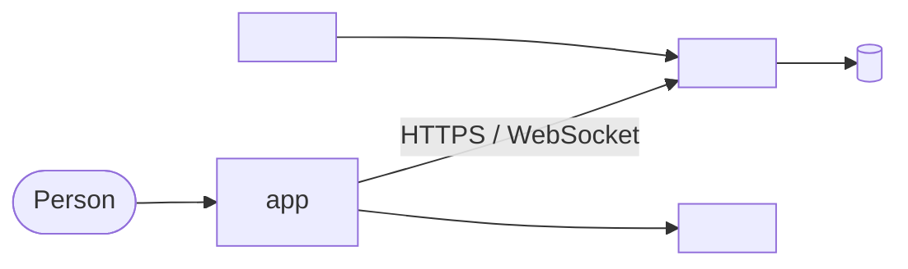
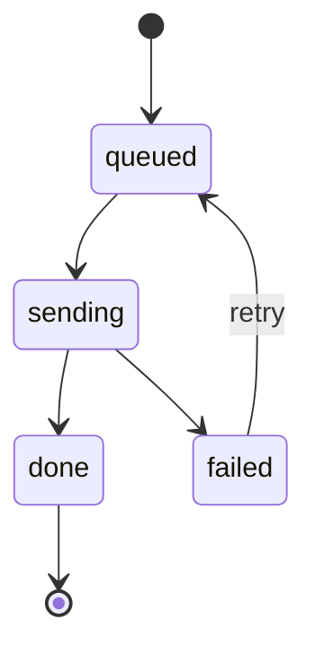
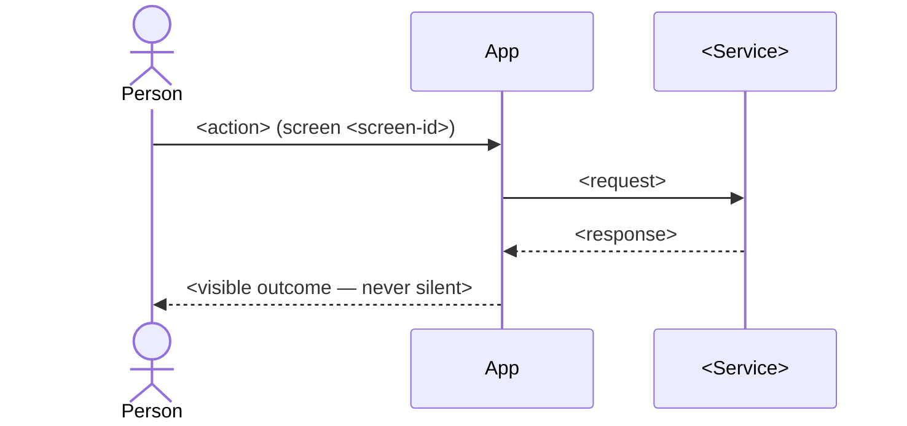
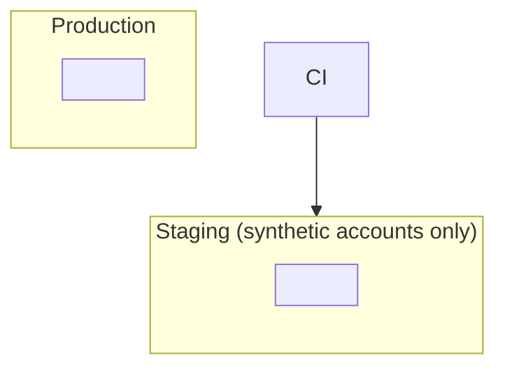

# <PRODUCT> — Architecture

<!-- Guidance: how the pieces fit. Brownfield: written from the code; every claim about what
exists is [V] with file:line. Greenfield: a target design; everything is [P] until built.
Diagrams in mermaid, compiled with mmdc before the file is done. Keep sections; drop ones that do
not apply and say so. -->

### Which document wins

`docs/delivery/DECISIONS.md` > `.specify/memory/constitution.md` > the atlas > `specs/` > this
file. Where this file disagrees with one of those, it is wrong; the conflict is listed in §12 and
in `docs/delivery/DISCREPANCIES.md`.

### Markers used in this file

- **[V]** verified in the code at the cited `path:line` (commit `<sha>`).
- **[P]** proposed by a spec or this initiative; not built yet.
- **[?]** believed true, not verified.

## 1. What this is
<Product, users, platforms; the build split (this build, later builds) and why.>

## 2. Constraints
<From the constitution and decisions: the ones that shape the architecture.>

## 3. System context
<The app, its backend services, third parties (auth, payments, notifications), other clients
sharing the backend. Evidence: graphify-out/GRAPH_REPORT.md (brownfield).>

<For reviews: the archify version lives in docs/diagrams/architecture.json (+ .html), converted
from this source and validated.>

## 4. App architecture
### 4.1 Layers today [V]
### 4.2 Modules after this initiative [P]
<Each spec → its module path.>
### 4.3 State
### 4.4 Navigation
### 4.5 Design system
### 4.6 Flags

## 5. Data
### 5.1 What lives on the device / in the client
### 5.2 Schemas
### 5.3 Sync and the outbox

### 5.4 Encryption and retention

## 6. Key flows
<One sequence diagram per flow a person relies on: sign-in → first run; create; find; share;
export; sync.>

### 6.1 <Flow name>

## 7. <Domain-specific engine, e.g. on-device intelligence, matching engine>

## 8. Security model
### 8.1 What the server sees
### 8.2 Threats and mitigations
### 8.3 Controls at the screen

## 9. Backend boundary
<What this build calls, what it does not; link BACKEND-SPLIT.md and BACKEND-AUDIT.md.>

## 9a. Deployment

## 10. Testing architecture
<Three layers: tools, where tests live, golden matrix, E2E harness, capture build, parity tooling,
coverage gate.>

## 11. Risks and open decisions
### Risks
### Open decisions that block design (each → OPEN-QUESTIONS.md id)

## 12. Conflicts found while writing this
<Each → DISCREPANCIES.md id.>
