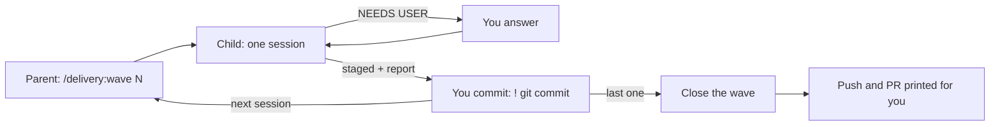

# Run sheet — <PRODUCT> <initiative>

<!-- Guidance: written by the sessionize skill next to SESSIONS.md (docs/delivery/RUN-SHEET.md). It
says only what to type and when; the prompts are in SESSIONS.md. Under each wave, one
"#### <step>. <name> — <summary> · <KEY>" heading per session, every session exactly once, each after
everything it depends on. Check it with `python3 tools/runsheet.py RUN-SHEET.md --sessions SESSIONS.md`.
Lines starting with `/` are typed inside Claude Code, lines starting with `!` too (they run in the
shell from the same chat); the rest in a terminal at the repo root. Remove these comments when filled in. -->

One command per wave. Owner decisions: `docs/delivery/DECISIONS.md`. How the sessions were cut:
`SESSIONS-EXPLAINED.md`.

## Once, before anything

```
claude --version
/plugin marketplace add arunma/delivery-framework    # inside Claude Code, then:
/plugin install delivery@delivery-framework
tail -c1 .env | xxd | grep -q 0a || echo >> .env    # .env must end with a newline before you append
git check-ignore -v docs/delivery specs design      # must print nothing, or the plan cannot be committed
```

## How a wave runs



- **One command per wave**, in a Claude Code session at the repo root. It checks the wave branch
  (`wave/<closing key>-<wave-name>`, from an up-to-date base branch (`base_branch` in `.delivery/profile.json`, default `main`); it offers to create or switch to it),
  shows done / next / remaining, and runs each session in a fresh child agent, in dependency order.
- **Questions come to you.** A child that needs a decision stops; the parent asks you and passes
  the answer back. Don't let it decide product questions.
- **You commit, in the same chat.** After each session it shows the report and the staged diff.
  Check the report against SESSIONS.md *How to tell a session actually finished*, then type
  `! git diff --staged` and `! git commit -m "<KEY>: <summary>"`. The agent never commits or pushes.
- **Strictly in order**, unless two blocks say *Parallel with* each other and you opt in.
- **Resumable.** Re-run the same `/delivery:wave` at any time (after `/clear`, the next day): it
  picks up at the next session with no commit.

## Foundation — `wave/<KEY>-NN-foundation`

```
/delivery:wave foundation
```

#### 1. foundation-flag — The flag, identifiers, the E2E wrapper, goldens and parity tooling · <KEY>-NN

After: nothing.

## Wave 1 — <theme> — `wave/<KEY>-NN-wave-1`

```
graphify update .                       # refresh the code graph, then inside Claude Code:
/delivery:wave 1
```

#### 2. widgets-domain — <what a person can do when it is done> · <KEY>-NN

After: foundation-flag.

#### 3. widgets-screens — <what a person can do when it is done> · <KEY>-NN

After: widgets-domain.

#### 4. close-wave-1 — Close wave 1 · <KEY>-NN

After: widgets-domain, widgets-screens. The wave's close, run last by the same command.

## Wave end — push and PR

The parent prints these after the close; run them yourself:

```
! git log --oneline <base>..wave/<KEY>-NN-wave-1   # one commit per session, each with its key
! git push -u origin wave/<KEY>-NN-wave-1
! gh pr create --base <base> --head wave/<KEY>-NN-wave-1 --title "<wave title>" --body "<keys>"
# review the PR, merge it, then:
! git switch <base> && git pull
```

## Troubleshooting

| Symptom | Do |
| --- | --- |
| A session stopped short (context ran out) | It wrote `specs/NNN-*/HANDOFF.md` and left the ticket In Progress. Accept the parent's offer of a fresh child for the same session, or re-run `/delivery:wave`. |
| A session blocked on a contradiction | It wrote `docs/delivery/DISCREPANCIES.md`; answer the question the parent asks. |
| The parent's conversation is getting long | `/clear`, then the same `/delivery:wave`. Commits, `tasks.md` and HANDOFF files hold the state. |
| Work staged but not committed | Commit it with `!` before going on; the next session will not start over staged work. |
| You want one session by hand | `/delivery:session <name>` in a fresh Claude Code session (paste the block if the plugin is missing). |
| `git commit` from the agent is blocked | Intended. Commit with `!`. `touch .delivery/APPROVED` allows agent commits *and* pushes for its whole window; delete it right after. |
