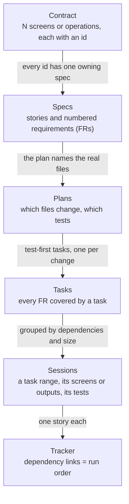
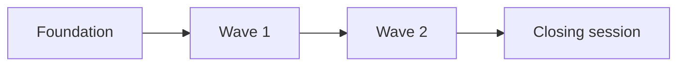

# How the sessions are derived — <PRODUCT> <initiative>

<!-- Guidance: written by the sessionize skill (docs/delivery/SESSIONS-EXPLAINED.md) for people who
did not plan the build: engineers, a PM, a reviewer. Sections 1 and 2 change little; regenerate
the table in section 4 whenever SESSIONS.md changes. Fill the counts from the files, never from
memory. Remove these comments when filled in. -->

A **session** is one slice of work that one engineer runs in one fresh Claude Code session
(`/delivery:session <name>`). It is small enough to finish inside one context window, and it ends
with its work staged, tested, checked against the contract and its ticket closed. This build has
<N> sessions. The prompts are in `SESSIONS.md`; the commands to run them are in `RUN-SHEET.md`.

## 1. The chain: from the contract to the tracker

Each layer is derived from the one above it, and each link is checked by a script.

| Link | Check |
| --- | --- |
| Contract → specs | Every contract id is cited by a requirement (`/delivery:verify-specs`) |
| Specs → tasks | Every FR has a task (the coverage table at the end of each `tasks.md`) |
| Tasks → sessions | Every task is in exactly one session (`sessionize.py validate --strict`) |
| Sessions → tracker | One story per session; each dependency is a *Blocks* link (`create_tickets.py --dry-run`) |
| Sessions → run sheet | Every session once, in dependency order (`runsheet.py`) |

## 2. How the tasks were cut into sessions

Five rules, applied in this order:

1. **Dependencies first.** Nothing is built on something that does not exist yet.
2. **One spec at a time where possible.** A session usually covers a range of one spec's tasks.
   <Name any session that crosses specs on purpose, and why.>
3. **Engines before screens.** Logic with no screen of its own is built and unit-tested first, so
   the screens that use it are not retro-fitted.
4. **Fits one context.** A session that would not fit is split into named parts, each its own story
   that closes itself. A part's screens or outputs are complete enough to check on their own.
   <N> sessions were split; <names> were measured and stayed whole.
5. **Split at seams.** A split falls where the code naturally divides (domain and store, engine and
   screen), never in the middle of a story.

## 3. Names and waves

A session's name is `<area>-<what>` in kebab case: `labels-domain` is the labels area, its domain
logic. The step number in the table below is the order to run in. A wave ends with
`close-<wave-name>` (`close-foundation`, `close-wave-1`), which writes no new feature: it re-runs
every check, lists what is really not done and turns mistakes into rules. Then the wave branch,
`wave/<closing key>-<wave-name>`, is pushed and one PR opened.

<If the plan was renamed from codes, keep the old → new table here so tickets and notes still
resolve.>

| Old id | Name |
| --- | --- |
| <S03a1> | <labels-domain> |

## 4. Every session

| Step | Session | Ticket | Spec | Depends on | What it delivers |
| --- | --- | --- | --- | --- | --- |
| 1 | foundation-flag | <KEY>-NN | 000 | — | The flag, identifiers, the E2E wrapper, goldens and parity tooling |
| 2 | widgets-domain | <KEY>-NN | <NNN> | foundation-flag | <what a person can do when it is done> |
| 3 | widgets-screens | <KEY>-NN | <NNN> | widgets-domain | <what a person can do when it is done> |
| 4 | close-wave-1 | <KEY>-NN | — | widgets-domain, widgets-screens | Close wave 1 |
