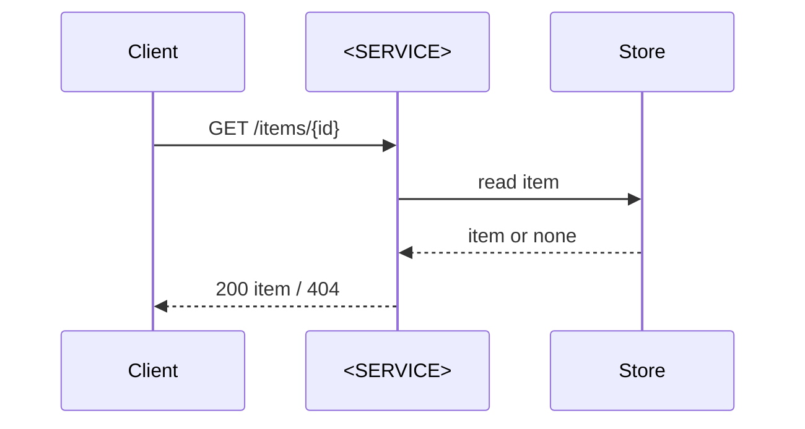

# API contract — <SERVICE>

<!-- Guidance: lives at contracts/api/README.md beside the machine-readable contract
(contracts/api/openapi.yaml, asyncapi.yaml or *.proto). The machine-readable file is the contract;
this page explains it and holds the sequence diagrams. Every change to the API starts here, is
validated, and only then is specified and built. Specs cite operation ids. Remove these comments
once filled in. -->

**Contract file:** `contracts/api/openapi.yaml` · **Version:** <semver> · **Owner approved:** <date, DECISIONS id>

## Consumers

| Consumer | Operations used | Consumer-driven tests (where) |
| --- | --- | --- |
| <app, service or partner> | `getItem`, `listItems` | `<path to pact or consumer test>` |

## Operations

| Operation id | Method and path | Purpose | Errors (code → meaning) | Idempotent | Auth |
| --- | --- | --- | --- | --- | --- |
| `getItem` | `GET /items/{id}` | <one line> | 404 → no such item | yes | <scheme> |

## Key sequences



## Compatibility rules

- Additive changes (new optional field, new operation) are MINOR. Removing or renaming a field,
  tightening validation or changing a status code is MAJOR and needs every consumer listed above to
  agree, in `DECISIONS.md`.
- The contract diff gate compares the committed contract with the one the built service serves
  (or generates). An empty diff passes; a non-empty diff passes only when the spec names it.

## Verification (the gate that plays parity's role)

1. Contract tests: every operation, every documented error, against an ephemeral or staging
   environment with synthetic data. Name the tool: <e.g. schema-driven tests, provider verification>.
2. Consumer-driven tests for every consumer above.
3. Contract diff: `<command>` prints no unexpected change.

## Minimal example (`contracts/api/openapi.yaml`)

```yaml
openapi: 3.1.0
info: { title: <SERVICE>, version: 0.1.0 }
paths:
  /items/{id}:
    get:
      operationId: getItem
      parameters: [{ name: id, in: path, required: true, schema: { type: string } }]
      responses:
        "200": { description: The item }
        "404": { description: No such item }
```
