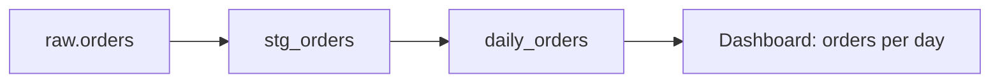

# Data contract — <DATASET or PIPELINE>

<!-- Guidance: lives at contracts/data/<dataset>.md, with machine-readable schemas beside it
(contracts/data/<dataset>.schema.json, dbt schema.yml, or the tool's equivalent). The contract is the
source of truth for the pipeline's output: specs cite dataset and column names, and the verification
gate checks the output against the golden dataset's answer key. Synthetic data only. Remove these
comments once filled in. -->

**Producer:** <pipeline or job> · **Consumers:** <dashboards, services, teams> · **Version:** <semver>
· **Owner approved:** <date, DECISIONS id>

## Schema and data dictionary

| Column | Type | Nullable | Unique | Meaning | Allowed values or range | Source (lineage) |
| --- | --- | --- | --- | --- | --- | --- |
| `order_date` | date | no | no | Day the order was placed, UTC | 2020-01-01 … today | `raw.orders.created_at` |
| `orders` | integer | no | no | Orders placed that day | ≥ 0 | count of `raw.orders` |

Primary key: `(order_date)`. Partitioning: <by day>. Sensitive columns: <none, or which and how they are masked>.

## Lineage

## Service levels

| Measure | Target | How it is checked |
| --- | --- | --- |
| Freshness | Data for day D available by D+1 06:00 UTC | `<freshness check>` |
| Completeness | Row count within ±<n>% of the source | `<check>` |
| Run time | under <n> min on <environment> | measured, `<benchmark>` |

## Data-quality checks (run on every build and every scheduled run)

- Row counts against the source and against the golden dataset's answer key.
- No nulls in non-nullable columns; unique keys unique; referential checks for every foreign key.
- Accepted values and ranges from the dictionary above.

## Change rules

Adding a nullable column is MINOR. Removing or renaming a column, changing a type or a meaning, or
tightening a range is MAJOR and needs every consumer's agreement in `DECISIONS.md`.

## Verification (the gate that plays parity's role)

1. The pipeline runs on the golden dataset (`contracts/data/golden/`, see GOLDEN-DATASET.md).
2. Its output equals the committed answer key, row for row (`<diff command>` prints nothing).
3. The data-quality checks pass.
4. A second run from a clean state reproduces the same output (reproducibility).
